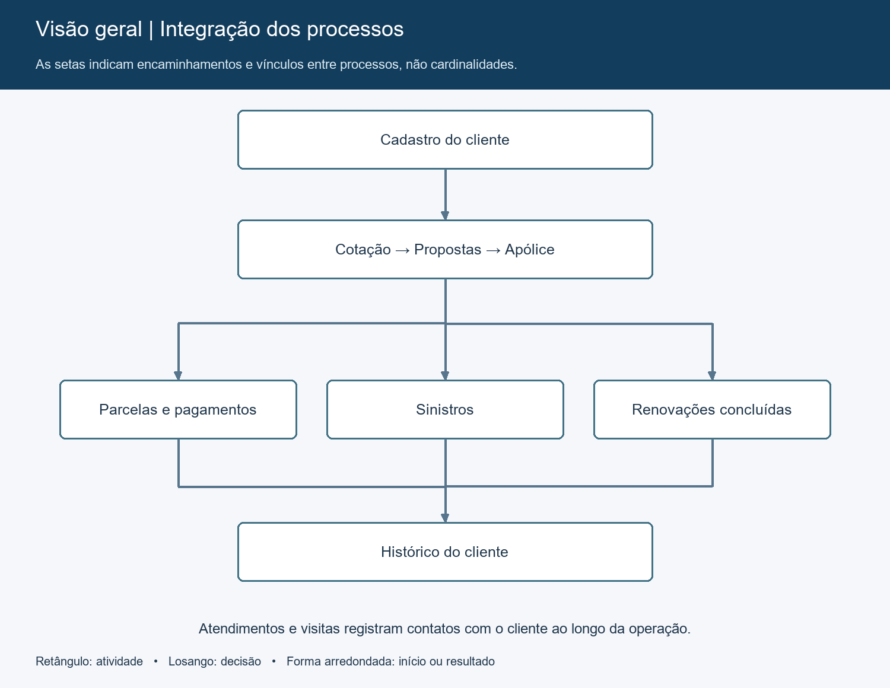
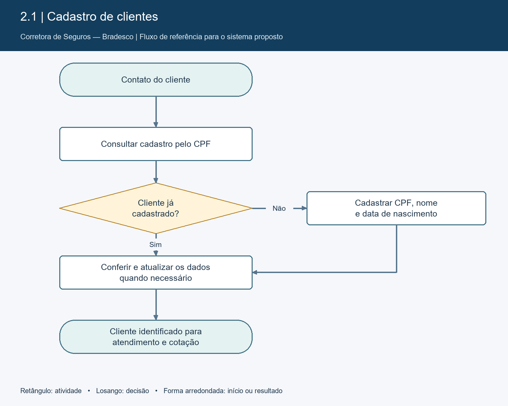
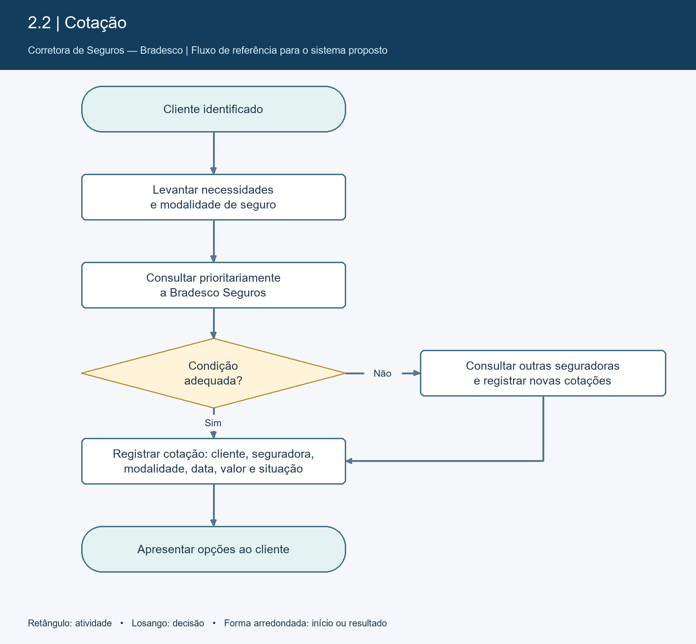
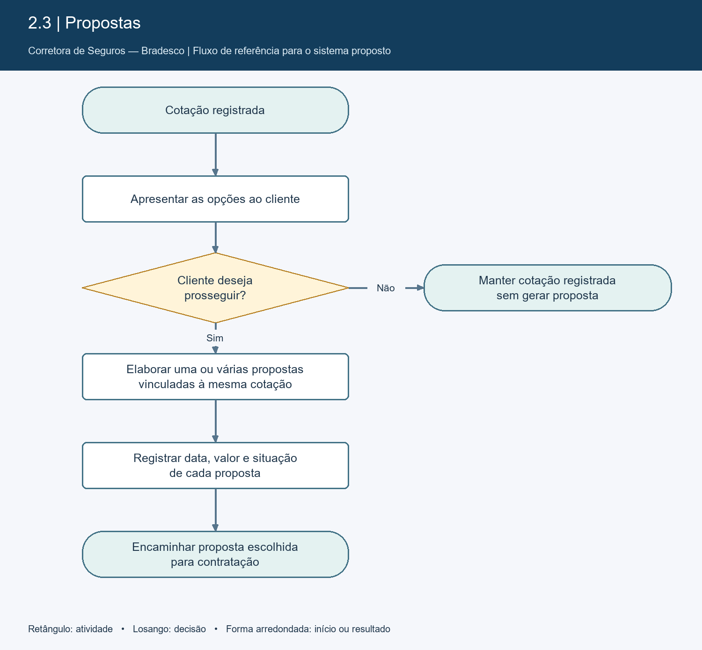
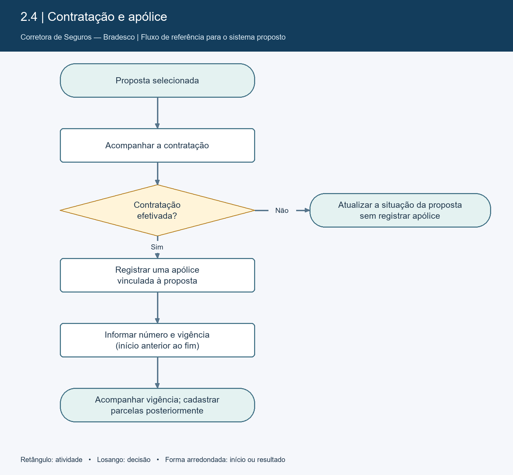
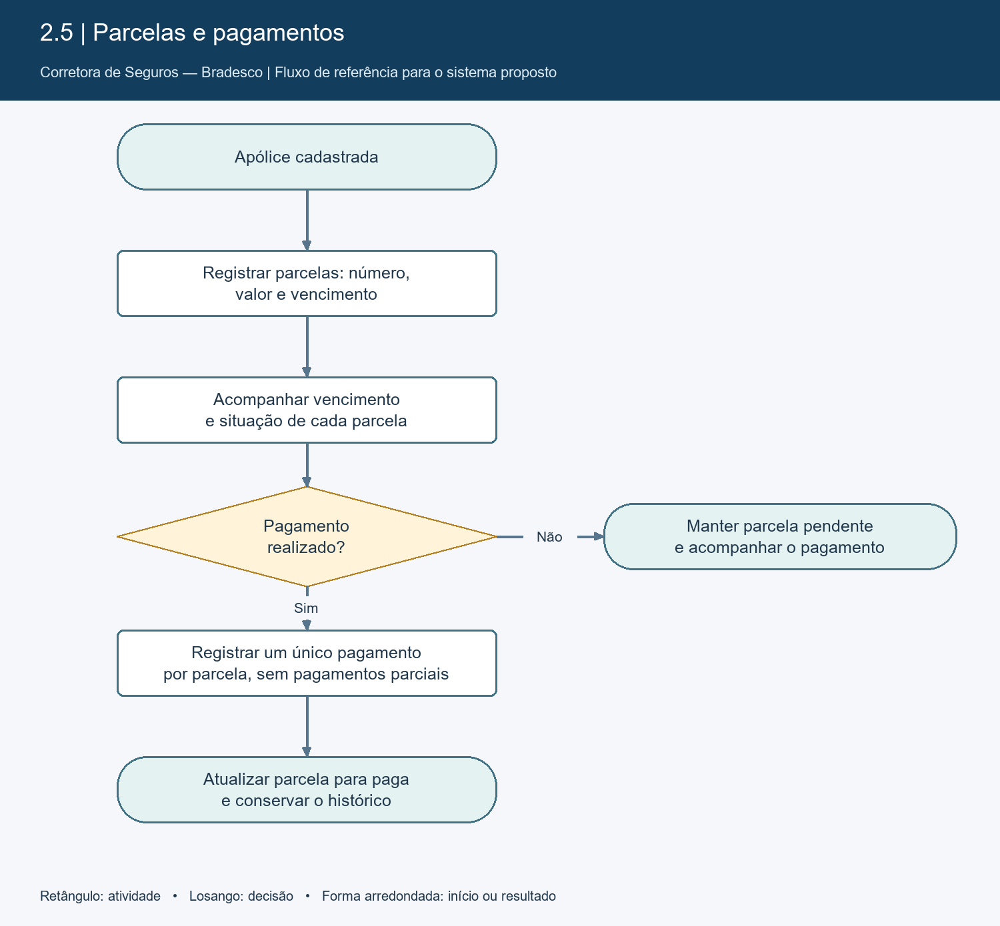
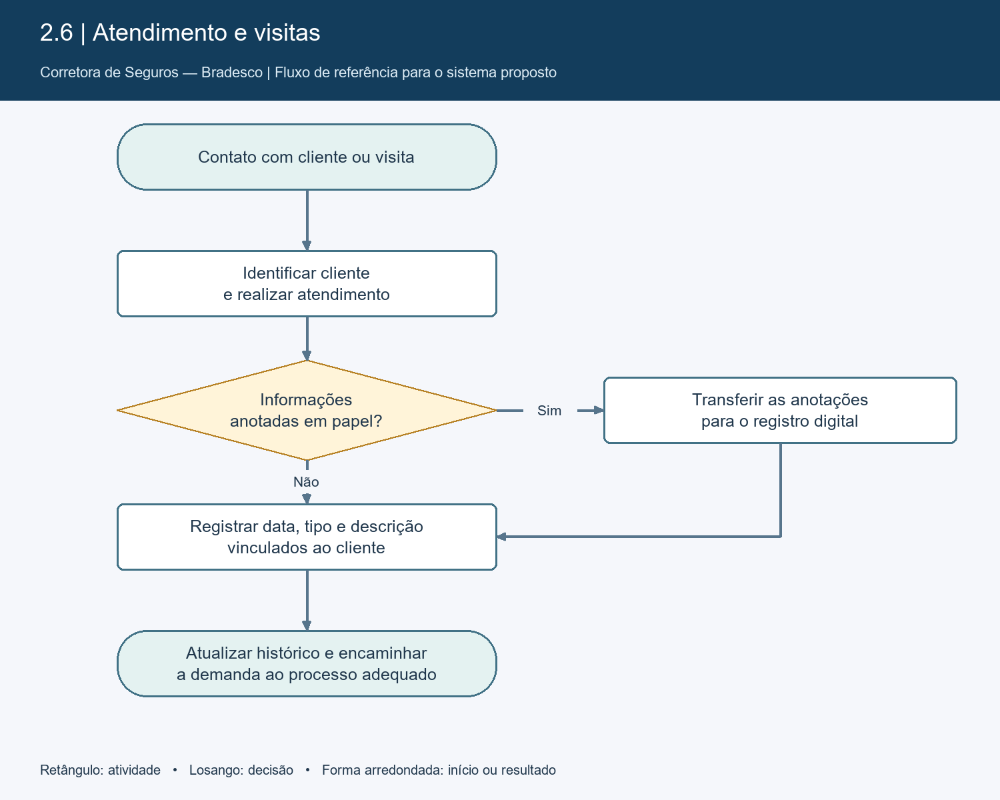
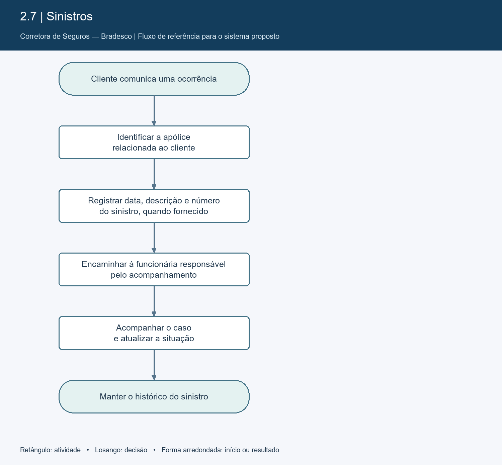
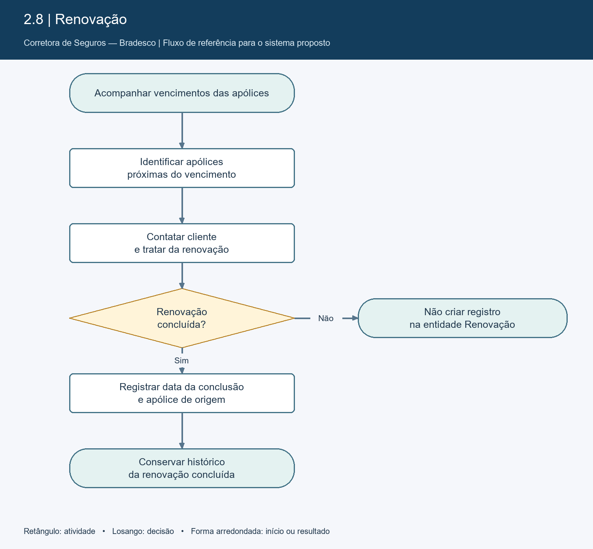
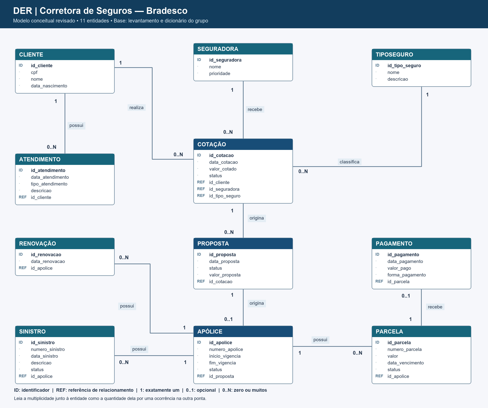

# PROJETO DE MODELAGEM DE BANCO DE DADOS

## Corretora de Seguros — Bradesco

> **Entrega 1 — Modelo Conceitual (DER)**

[Dicionário de dados em HTML](dicionario-dados/dicionario_de_dados.html) · [Diagrama Entidade-Relacionamento](der/DER-corretora.jpeg)

## Metadados

| Integrante | RGM |
| --------------------------- | -------- |
| Mateus Martins Gonçalves    | 47812222 |
| Raul Borges Sim             | 48247634 |
| João Gustavo Bento de Souza | 42283671 |
| Victor Alves Rodrigues Braulino | 48216305 |

---

# 1. Caracterização da Organização

## 1.1 Nome e natureza da organização

O objeto deste projeto é a operação de **corretagem de seguros que atua junto ao Bradesco**, conforme relato do grupo. A visita e a entrevista foram realizadas no **Banco Bradesco — Agência 1363**, situado na **Av. Dr. Chucri Zaidan, 80 — Itaim Bibi, São Paulo — SP, CEP 04583-110, Brasil**. As fotografias identificam o local visitado como **Bradesco Empresas e Negócios**. O modelo abrange a operação de seguros descrita na entrevista, e não o banco Bradesco como um todo.

A organização atua no segmento de seguros, oferecendo diferentes modalidades de produtos para seus clientes. Entre os tipos de seguros trabalhados estão:

- Seguro Auto;
- Seguro Residencial;
- Seguro Empresarial;
- Seguro de Vida;
- Seguro Saúde;
- Seguro Dental;
- Outros tipos de seguros disponibilizados pelas companhias parceiras.

A corretora possui fins lucrativos e está em funcionamento desde **2016**.

## 1.2 Contexto e porte

Atualmente, a organização conta com aproximadamente **6 funcionários**.

De acordo com as informações obtidas durante a pesquisa de campo, a corretora atende aproximadamente **50 a 100 clientes por mês** e comercializa cerca de **50 a 60 seguros mensalmente**, considerando todos os produtos oferecidos.

O faturamento médio mensal informado é de aproximadamente **R$ 60.000,00**.

A operação envolve diversas atividades, incluindo cadastro de clientes, atendimento, elaboração de cotações, acompanhamento de propostas, contratação de seguros, controle de apólices, acompanhamento de parcelas e pagamentos, atendimento de sinistros e renovação de apólices.

## 1.3 Problemas e necessidades identificados

Durante a pesquisa de campo, foi observado que grande parte das informações operacionais é controlada por meio de **Excel e Google Planilhas**.

As cotações e propostas são acompanhadas por planilhas, assim como os pagamentos e parcelas dos seguros.

O acompanhamento dos atendimentos também utiliza planilhas. Em determinadas situações, durante uma visita ao cliente, as informações são inicialmente anotadas em **folhas de papel** e posteriormente utilizadas para atualizar os controles.

A organização também utiliza um **quadro de vidro** para organizar as visitas que serão realizadas durante a semana.

Outro processo específico é o acompanhamento de sinistros, que é realizado por uma funcionária especializada nessa atividade, responsável pelas listagens e pelo acompanhamento dos casos.

As renovações são acompanhadas por Excel e Google Planilhas. A corretora também recebe um link da sucursal, no qual são registrados os seguros fechados, auxiliando na identificação das apólices próximas ao vencimento.

### Principais problemas identificados

- Informações distribuídas entre Excel e Google Planilhas;
- Dependência de controles manuais;
- Utilização de papel durante determinados atendimentos e visitas;
- Necessidade de atualizar informações manualmente após as visitas;
- Controle visual de visitas por meio de quadro de vidro;
- Dificuldade de centralizar o histórico dos clientes;
- Controle manual de parcelas e pagamentos;
- Necessidade de acompanhar constantemente os vencimentos das apólices;
- Controle das renovações realizado por diferentes ferramentas;
- Informações de sinistros concentradas em um controle específico.

Diante desse cenário, o projeto propõe a modelagem de um banco de dados capaz de **centralizar e organizar as principais informações da corretora**.

---

## 1.4 Justificativa da escolha

A corretora foi escolhida por ser uma organização real na qual o grupo teve acesso para realizar pesquisa de campo e levantar informações diretamente relacionadas aos processos de negócio.

A organização apresenta características adequadas para um projeto de banco de dados, pois trabalha diariamente com grande quantidade de informações relacionadas a clientes, seguros, seguradoras, cotações, propostas, apólices, pagamentos, atendimentos, sinistros e renovações.

Além disso, a utilização de Excel, Google Planilhas e registros manuais demonstra uma oportunidade de melhoria por meio da centralização das informações em um banco de dados.

A escolha também possibilita desenvolver um modelo que poderá futuramente ser utilizado como base para um sistema informatizado de gerenciamento da corretora.

---

## 1.5 Evidências da organização e da pesquisa de campo

A pesquisa de campo foi realizada presencialmente nas instalações da organização.

As fotografias abaixo foram fornecidas pelo grupo como evidências das instalações visitadas durante a pesquisa de campo.

### Foto 1 — Ambiente interno da organização

A primeira fotografia apresenta uma área interna da organização, com salas individuais separadas por divisórias de vidro e estrutura destinada à realização das atividades profissionais.

### Foto 2 — Identificação visual da organização

A segunda fotografia apresenta a identificação visual **“Bradesco Empresas e Negócios”** presente nas instalações visitadas.

### Foto 3 — Fachada do local visitado

A terceira fotografia apresenta a fachada e a entrada do local visitado, com a identificação visual Bradesco.

### Dados da organização

| Informação | Dado |
| ---------------------------- | ------------------------- |
| Local da visita e da entrevista | Banco Bradesco — Agência 1363 |
| Segmento                     | Corretora de seguros      |
| Início das atividades        | 2016                      |
| Quantidade de funcionários   | 6                         |
| Endereço                     | Av. Dr. Chucri Zaidan, 80 — Itaim Bibi, São Paulo — SP, CEP 04583-110, Brasil |
| E-mail informado             | alicelimna@gmail.com     |
| Responsável entrevistada     | Patrícia dos Santos Souza |
| Cargo                        | Sócia                     |
| Google Maps/Site/Rede social | Não informado             |

---

# 2. Processos de Negócio

Com base na entrevista e na observação realizada durante a visita, foram identificados os seguintes processos.

Os fluxogramas representam os processos mapeados e seu registro no sistema proposto.

## 2.1 Cadastro de clientes

O cadastro é realizado quando um cliente entra em contato com a corretora.

As principais informações levantadas são:

- CPF;
- Nome;
- Data de nascimento.

Essas informações são utilizadas para identificar o cliente e relacioná-lo aos demais processos da corretora.

---

## 2.2 Cotação

Após o levantamento das necessidades do cliente, a corretora realiza uma ou mais cotações.

A organização trabalha com diversos tipos de seguros e consulta diferentes seguradoras.

A **Bradesco Seguros é priorizada** nas cotações. Quando não é encontrada uma condição adequada, a corretora realiza cotações com outras companhias.

Atualmente, o acompanhamento dessas cotações é realizado por meio de Excel e Google Planilhas.

### Fluxo

**Cliente → Levantamento das necessidades → Cotação → Análise das opções → Escolha da opção**

---

## 2.3 Proposta

Após a realização da cotação, caso o cliente tenha interesse em prosseguir, podem ser elaboradas várias propostas para apresentar diferentes opções ao cliente.

A proposta representa a etapa entre a cotação e a efetiva contratação do seguro.

### Fluxo

**Cotação → Cliente analisa → Aceita prosseguir → Proposta**

Caso o cliente não prossiga, a cotação permanece registrada sem necessariamente resultar em uma apólice.

---

## 2.4 Contratação e apólice

Quando a contratação é efetivada, é gerada uma apólice.

As principais informações de apólice identificadas na pesquisa são:

- Número da apólice;
- Vigência.

A vigência representa o período durante o qual o seguro permanece válido.

### Fluxo

**Proposta → Contratação → Apólice → Controle da vigência**

---

## 2.5 Controle de parcelas e pagamentos

A corretora acompanha os pagamentos e parcelas por meio de Excel e Google Planilhas.

O sistema proposto deverá permitir relacionar cada parcela à sua respectiva apólice e registrar a situação do pagamento.

### Fluxo

**Apólice → Parcelas → Vencimento → Pagamento → Atualização do status**

---

## 2.6 Atendimento ao cliente

Os atendimentos são registrados nas planilhas de acompanhamento.

Durante visitas, os dados podem ser inicialmente registrados em papel e posteriormente transferidos para os controles digitais.

Além disso, um quadro de vidro é utilizado para organizar as visitas previstas para a semana.

### Fluxo

**Cliente → Atendimento/Visita → Levantamento de informações → Registro → Atualização do acompanhamento**

---

## 2.7 Sinistros

O processo de sinistros possui tratamento específico dentro da organização.

Uma funcionária é responsável pelo acompanhamento dos sinistros e pelas listagens relacionadas a eles.

O modelo proposto deverá permitir relacionar cada sinistro ao cliente e à apólice correspondente.

### Fluxo

**Cliente → Comunicação do sinistro → Registro → Acompanhamento → Atualização da situação**

---

## 2.8 Renovação

As renovações são acompanhadas por Excel e Google Planilhas.

A corretora também utiliza informações disponibilizadas pela sucursal para identificar seguros que estão próximos do vencimento.

Quando uma apólice se aproxima do vencimento, a corretora entra em contato com o cliente para tratar da renovação.

### Fluxo

**Apólice → Verificação do vencimento → Contato com cliente → Renovação concluída → Registro da renovação**

Se o contato não resultar em renovação, não é criado registro na entidade Renovação.

---

# 3. Requisitos do Sistema

## 3.1 Requisitos Funcionais

| Código | Requisito funcional |
| ------------------------- | ------------------------------------------------------------------------------------------- |
| RF01                      | O sistema deve permitir cadastrar clientes.                                                 |
| RF02                      | O sistema deve permitir consultar clientes.                                                 |
| RF03                      | O sistema deve permitir atualizar dados dos clientes.                                       |
| RF04                      | O sistema deve permitir cadastrar tipos de seguros.                                         |
| RF05                      | O sistema deve permitir cadastrar seguradoras.                                              |
| RF06                      | O sistema deve permitir registrar cotações.                                                 |
| RF07                      | O sistema deve permitir relacionar uma cotação a um cliente.                                |
| RF08                      | O sistema deve permitir relacionar uma cotação a uma seguradora.                            |
| RF09                      | O sistema deve permitir registrar propostas.                                                |
| RF10                      | O sistema deve permitir acompanhar o status das propostas.                                  |
| RF11                      | O sistema deve permitir registrar apólices.                                                 |
| RF12                      | O sistema deve permitir registrar número e vigência da apólice.                             |
| RF13                      | O sistema deve permitir cadastrar parcelas.                                                 |
| RF14                      | O sistema deve permitir registrar pagamentos.                                               |
| RF15                      | O sistema deve permitir consultar parcelas pendentes e pagas.                               |
| RF16                      | O sistema deve permitir registrar atendimentos.                                             |
| RF17                      | O sistema deve permitir registrar sinistros.                                                |
| RF18                      | O sistema deve permitir acompanhar o status dos sinistros.                                  |
| RF19                      | O sistema deve identificar apólices próximas do vencimento.                                 |
| RF20                      | O sistema deve permitir registrar somente renovações concluídas.                                               |
| RF21                      | O sistema deve manter o histórico do cliente.                                               |
| RF22                      | O sistema deve permitir pesquisar informações por cliente, apólice, seguradora ou situação. |

---

## 3.2 Requisitos Não Funcionais

| Código | Requisito não funcional |
| ----------------------------- | ---------------------------------------------------------------------------- |
| RNF01                         | O sistema deve possuir interface simples e intuitiva.                        |
| RNF02                         | O acesso às informações deve ser protegido por autenticação.                 |
| RNF03                         | O sistema deve restringir o acesso aos dados conforme o perfil do usuário.   |
| RNF04                         | O sistema deve apresentar bom desempenho nas consultas.                      |
| RNF05                         | O banco deve preservar a integridade dos dados.                              |
| RNF06                         | O sistema deve permitir realização de backups periódicos.                    |
| RNF07                         | O sistema deve evitar duplicidade de clientes.                               |
| RNF08                         | O sistema deve permitir a inclusão de novos tipos de seguros.                |
| RNF09                         | O sistema deve permitir a inclusão de novas seguradoras.                     |
| RNF10                         | O sistema deve preservar a confidencialidade dos dados pessoais armazenados. |

---

# 4. Regras de Negócio

## 4.1 Regras operacionais e de integridade

As regras abaixo combinam informações do levantamento e restrições propostas para o sistema. As cardinalidades constituem decisões da proposta de modelagem.

| Código | Regra |
| ----------- | --------------------------------------------------------------------------------------------- |
| RN01        | Cada cliente deve possuir CPF, nome e data de nascimento cadastrados.                         |
| RN02        | O CPF deve identificar unicamente um cliente.                                                 |
| RN03        | A corretora trabalha com diferentes tipos de seguros.                                         |
| RN04        | Uma cotação deve estar associada a um cliente.                                                |
| RN05        | Uma cotação deve estar associada a uma seguradora.                                            |
| RN06        | A Bradesco Seguros é priorizada nas cotações, conforme informação fornecida pela organização. |
| RN07        | Outras seguradoras podem ser consultadas quando necessário.                                   |
| RN08        | Cada proposta tem uma cotação de origem; uma cotação pode gerar várias propostas ou nenhuma.                                      |
| RN09        | Nem toda cotação necessariamente resulta em uma proposta.                                     |
| RN10        | Uma apólice deve possuir número e período de vigência.                                        |
| RN11        | A data inicial da vigência deve ser anterior à data final.                                    |
| RN12        | Uma apólice pode ser cadastrada antes das parcelas e posteriormente possuir várias parcelas.                                                     |
| RN13        | Uma parcela deve estar vinculada a uma apólice.                                               |
| RN14        | Cada pagamento pertence a uma parcela; cada parcela recebe no máximo um pagamento, sem pagamentos parciais.                                            |
| RN15        | Cada sinistro pertence a uma apólice; uma apólice pode ter vários sinistros durante sua vigência.                                             |
| RN16        | Os sinistros possuem acompanhamento específico dentro da organização.                         |
| RN17        | Os atendimentos devem estar relacionados aos clientes.                                        |
| RN18        | As apólices devem ser acompanhadas quanto ao vencimento.                                      |
| RN19        | Somente renovações concluídas devem ser registradas; tentativas sem renovação não são armazenadas.                                             |
| RN20        | As informações dos clientes devem ser protegidas contra acesso não autorizado.                |

---

## 4.2 Restrições organizacionais e impacto no modelo

| Código | Restrição / origem | Efeito no modelo e motivo |
|---|---|---|
| RO01 | Preferência pela Bradesco Seguros, informada na entrevista. | Seguradora possui o indicador prioridade; outras companhias continuam cadastráveis (RN06/RN07). |
| RO02 | Controles distribuídos entre planilhas, papel e quadro de visitas. | Cliente centraliza os vínculos; Atendimento registra data, tipo e descrição para conservar o histórico (RF16/RF21). O calendário completo de visitas está fora do escopo do modelo. |
| RO03 | Vigência e renovação exigem acompanhamento. | Apólice possui início/fim de vigência; Renovação registra a conclusão e a apólice relacionada. Esses dados permitem consultar os vencimentos (RF19/RF20). |
| RO04 | Sinistros são acompanhados por uma funcionária específica. | Sinistro é uma entidade própria, vinculada à apólice, com data, descrição e status. |
| RO05 | Confidencialidade e controle de acesso previstos nos requisitos do projeto. | CPF não deve ser repetido em entidades dependentes. Autenticação, perfis e backup são requisitos de implementação futura (RNF02/RNF03/RNF06/RNF10). |
| RO06 | Cadastro informado contém CPF, nome e nascimento. | O escopo atual representa pessoa física. O cadastro de pessoas jurídicas não está contemplado nesta proposta. |

---

# 5. Dicionário de Dados Conceitual (Preliminar)

O arquivo [dicionario_de_dados.html](dicionario-dados/dicionario_de_dados.html) contém as mesmas definições abaixo no formato HTML solicitado. Para visualizar a formatação, baixe-o e abra no navegador.

As entidades, atributos e referências estão padronizados entre README, HTML e DER. Os domínios e as cardinalidades apresentados constituem decisões de modelagem propostas. ID indica identificador; REF indica referência de relacionamento, não um atributo descritivo adicional. Não se trata de um esquema físico ou de uma implementação SQL.

## Cliente

| Atributo / referência | Descrição | Regra de negócio associada |
|---|---|---|
| `id_cliente` (ID) | Identificador interno do cliente | Único e obrigatório; identificador interno proposto. |
| `cpf` | CPF do cliente | Obrigatório e único |
| `nome` | Nome do cliente | Obrigatório |
| `data_nascimento` | Data de nascimento | Obrigatória |

## Seguradora

| Atributo / referência | Descrição | Regra de negócio associada |
|---|---|---|
| `id_seguradora` (ID) | Identificador da seguradora | Único e obrigatório; identificador interno proposto. |
| `nome` | Nome da seguradora | Obrigatório |
| `prioridade` | Indica prioridade comercial | Indicador proposto (Sim/Não). Representa a preferência comercial informada em RN06; não impede consultar outras seguradoras. |

## TipoSeguro

| Atributo / referência | Descrição | Regra de negócio associada |
|---|---|---|
| `id_tipo_seguro` (ID) | Identificador do tipo | Único e obrigatório; identificador interno proposto. |
| `nome` | Nome do seguro | Obrigatório |
| `descricao` | Descrição do produto | Opcional |

## Cotação

| Atributo / referência | Descrição | Regra de negócio associada |
|---|---|---|
| `id_cotacao` (ID) | Identificador da cotação | Único e obrigatório; identificador interno proposto. |
| `data_cotacao` | Data da cotação | Obrigatória |
| `valor_cotado` | Valor apresentado | Valor não negativo |
| `status` | Situação da cotação | Obrigatório. Domínio proposto: Em análise; apresentada; escolhida; não prosseguiu. |
| `id_cliente` (REF) | Cliente relacionado | Obrigatório; referencia exatamente uma ocorrência existente da entidade relacionada. |
| `id_seguradora` (REF) | Seguradora consultada | Obrigatório; referencia exatamente uma ocorrência existente da entidade relacionada. |
| `id_tipo_seguro` (REF) | Tipo de seguro | Obrigatório; referencia exatamente uma ocorrência existente da entidade relacionada. |

## Proposta

| Atributo / referência | Descrição | Regra de negócio associada |
|---|---|---|
| `id_proposta` (ID) | Identificador da proposta | Único e obrigatório; identificador interno proposto. |
| `data_proposta` | Data da proposta | Obrigatória |
| `status` | Situação da proposta | Obrigatório. Domínio proposto: Em análise; aceita; recusada; cancelada. |
| `valor_proposta` | Valor da proposta | Não negativo |
| `id_cotacao` (REF) | Cotação de origem | Obrigatório; referencia uma cotação existente. Pode se repetir entre propostas, pois uma cotação pode gerar várias propostas. |

## Apólice

| Atributo / referência | Descrição | Regra de negócio associada |
|---|---|---|
| `id_apolice` (ID) | Identificador interno | Único e obrigatório; identificador interno proposto. |
| `numero_apolice` | Número da apólice | Obrigatório |
| `inicio_vigencia` | Início da vigência | Obrigatório |
| `fim_vigencia` | Fim da vigência | Obrigatório e posterior a inicio_vigencia (RN11). |
| `status` | Situação da apólice | Obrigatório. Domínio proposto: Vigente; encerrada; cancelada. |
| `id_proposta` (REF) | Proposta de origem | Obrigatório; referencia exatamente uma ocorrência existente da entidade relacionada. Único nesta entidade no modelo proposto. |

## Parcela

| Atributo / referência | Descrição | Regra de negócio associada |
|---|---|---|
| `id_parcela` (ID) | Identificador da parcela | Único e obrigatório; identificador interno proposto. |
| `numero_parcela` | Número da parcela | Inteiro positivo; combinação de apólice e número da parcela deve ser única (decisão técnica). |
| `valor` | Valor da parcela | Maior que zero |
| `data_vencimento` | Data de vencimento | Obrigatória |
| `status` | Situação da parcela | Obrigatório. Domínio proposto: Pendente; paga. |
| `id_apolice` (REF) | Apólice relacionada | Obrigatório; referencia exatamente uma ocorrência existente da entidade relacionada. |

## Pagamento

| Atributo / referência | Descrição | Regra de negócio associada |
|---|---|---|
| `id_pagamento` (ID) | Identificador do pagamento | Único e obrigatório; identificador interno proposto. |
| `data_pagamento` | Data do pagamento | Obrigatória em todo registro de pagamento; parcela não paga não gera registro nesta entidade. |
| `valor_pago` | Valor pago | Maior que zero |
| `forma_pagamento` | Forma utilizada | Obrigatória. Registra a modalidade utilizada para quitar a parcela. |
| `id_parcela` (REF) | Parcela relacionada | Obrigatório; referencia exatamente uma ocorrência existente da entidade relacionada. Único nesta entidade no modelo proposto. |

## Atendimento

| Atributo / referência | Descrição | Regra de negócio associada |
|---|---|---|
| `id_atendimento` (ID) | Identificador | Único e obrigatório; identificador interno proposto. |
| `data_atendimento` | Data do atendimento | Obrigatória |
| `tipo_atendimento` | Tipo do atendimento | Obrigatório. Valores propostos: Atendimento; Visita. |
| `descricao` | Informações do atendimento | Opcional |
| `id_cliente` (REF) | Cliente atendido | Obrigatório; referencia exatamente uma ocorrência existente da entidade relacionada. |

## Sinistro

| Atributo / referência | Descrição | Regra de negócio associada |
|---|---|---|
| `id_sinistro` (ID) | Identificador | Único e obrigatório; identificador interno proposto. |
| `numero_sinistro` | Número do sinistro | Quando fornecido, deve ser registrado |
| `data_sinistro` | Data da ocorrência | Obrigatória |
| `descricao` | Descrição da ocorrência | Obrigatória |
| `status` | Situação do sinistro | Obrigatório. Domínio proposto: Registrado; em acompanhamento; encerrado. |
| `id_apolice` (REF) | Apólice relacionada | Obrigatório; referencia exatamente uma ocorrência existente da entidade relacionada. |

## Renovação

| Atributo / referência | Descrição | Regra de negócio associada |
|---|---|---|
| `id_renovacao` (ID) | Identificador | Único e obrigatório; identificador interno proposto. |
| `data_renovacao` | Data da renovação | Obrigatória; registra a data da renovação concluída |
| `id_apolice` (REF) | Apólice renovada | Obrigatório; referencia exatamente uma ocorrência existente da entidade relacionada. |

---

# 6. Modelagem Conceitual (Entidades, Atributos, Relacionamentos)

## 6.1 Entidades reconhecidas

| Entidade | Papel e justificativa |
|---|---|
| Cliente | Identifica a pessoa física que solicita cotações e recebe atendimentos; evita cadastros repetidos. |
| Seguradora | Identifica a companhia consultada, separando companhia de modalidade de seguro. |
| TipoSeguro | Mantém o catálogo de modalidades e permite cadastrar novos produtos sem criar novas entidades. |
| Cotação | Registra uma consulta para um cliente, em uma companhia e modalidade, mesmo sem contratação. |
| Proposta | Representa a etapa comercial que avança a partir de uma cotação. |
| Apólice | Registra o contrato efetivado e sua vigência. |
| Parcela | Separa cada obrigação de pagamento, com número, valor e vencimento. |
| Pagamento | Registra a ocorrência de pagamento; sua ausência permite representar uma parcela ainda não paga. |
| Atendimento | Conserva o histórico de contatos/visitas relacionado ao cliente. |
| Sinistro | Permite acompanhamento específico de ocorrências vinculadas a uma apólice. |
| Renovação | Registra somente a renovação concluída de uma apólice de origem. |

## 6.2 Atributos e classificações

Os atributos de cada entidade estão enumerados na seção 5 e no HTML. Todos são tratados como simples e monovalorados nesta abstração; nome e descrição são armazenados como uma unidade textual, sem decomposição adicional. Não há atributo multivalorado no escopo atual.

- **Identificadores:** `id_*` próprio de cada entidade, único e obrigatório. O CPF é um identificador de negócio alternativo para Cliente (RN02).
- **Descritivos:** nome, descrição, número de apólice/sinistro, tipo de atendimento e forma de pagamento.
- **Temporais:** nascimento, datas de cotação/proposta, vigência, vencimento, pagamento, atendimento, sinistro e renovação.
- **Quantitativos:** valores cotado/proposto, valor da parcela, valor pago e número da parcela.
- **Categóricos:** status e prioridade. Os domínios sugeridos são decisões técnicas, não respostas atribuídas à entrevistada.
- **Referências (REF):** os 10 campos de ligação `id_*` em outras entidades expressam os 10 relacionamentos abaixo. Cotação contém três referências; as demais entidades dependentes contêm uma. Eles antecipam o mapeamento dos vínculos sem definir tipos SQL, índices ou armazenamento físico.
- **Informações derivadas:** cliente de uma apólice, de um sinistro ou de uma renovação é obtido pela cadeia Apólice → Proposta → Cotação → Cliente. Proximidade do vencimento e atraso são calculados pelas datas; não são atributos adicionais.

O número da apólice não foi declarado único globalmente: o levantamento não confirmou se diferentes seguradoras podem reutilizar a mesma numeração.

## 6.3 Relacionamentos e cardinalidades

Na tabela, **Destinos por origem** informa quantas ocorrências do destino uma ocorrência da origem pode possuir. **Origens por destino** informa o sentido inverso. `0..N` significa zero ou muitas; `0..1`, zero ou uma; `1`, exatamente uma.

| Origem | Relação | Destino | Destinos por origem | Origens por destino | Interpretação |
|---|---|---|---|---|---|
| Cliente | realiza | Cotação | 0..N | 1 | Cada cotação pertence a um cliente; um cliente pode ainda não ter cotações. |
| Seguradora | recebe | Cotação | 0..N | 1 | Cada cotação consulta uma seguradora; o cadastro pode existir antes de uma consulta. |
| TipoSeguro | classifica | Cotação | 0..N | 1 | Cada cotação corresponde a uma modalidade; um tipo pode ainda não ter cotações. |
| Cotação | origina | Proposta | 0..N | 1 | Uma cotação pode originar várias propostas; cada proposta tem uma cotação de origem. |
| Proposta | origina | Apólice | 0..1 | 1 | uma proposta origina no máximo uma apólice; cada apólice tem uma proposta. |
| Apólice | possui | Parcela | 0..N | 1 | uma apólice pode ser cadastrada antes das parcelas; cada parcela tem uma apólice. |
| Parcela | recebe | Pagamento | 0..1 | 1 | uma parcela recebe no máximo um pagamento; cada pagamento pertence a uma parcela. |
| Cliente | possui | Atendimento | 0..N | 1 | Cada atendimento pertence a um cliente; o cliente pode ainda não ter atendimentos registrados. |
| Apólice | possui | Sinistro | 0..N | 1 | uma apólice pode não ter sinistros ou ter vários; cada sinistro pertence a uma apólice. |
| Apólice | possui | Renovação | 0..N | 1 | Cada registro representa uma renovação concluída de uma apólice de origem. |

## 6.4 Restrições e políticas aplicadas

RN02 impede duplicidade de CPF; RN11 exige início da vigência anterior ao fim; RN13/RN14/RN15/RN17 exigem vínculos válidos. A combinação apólice + número da parcela identifica a parcela dentro do contrato. Os vínculos em Apólice e Pagamento são únicos para respeitar o máximo de uma apólice por proposta e um pagamento por parcela. Em Proposta, id_cotacao pode se repetir, permitindo diferentes propostas para a mesma cotação.

Uma cotação de outra companhia ou modalidade constitui outro registro. Seguradora e TipoSeguro se relacionam por intermédio de Cotação: o levantamento não sustenta limitar uma seguradora a um único tipo de seguro.

No modelo proposto, pagamento representa a liquidação da parcela: não há linha de pagamento vazia para representar pendência. A atualização da parcela para paga deve acompanhar o registro do pagamento. Estornos, juros, descontos e pagamentos parciais estão fora do escopo desta proposta.

Renovação registra exclusivamente a conclusão da renovação vinculada à apólice de origem. Tentativas de contato sem renovação não geram registros nessa entidade. O modelo não estabelece um vínculo entre apólices sucessivas.

---

# 7. Diagrama Entidade-Relacionamento (DER)

[Abrir imagem em tamanho original](der/DER-corretora.jpeg).

O diagrama usa entidades em caixas, atributos internos, relacionamentos nomeados e cardinalidades nas extremidades. ID identifica a entidade; REF identifica os vínculos descritos na seção 6. A quantidade junto a uma caixa indica quantas ocorrências **daquela entidade** podem se relacionar a uma ocorrência da entidade na outra ponta (convenção de multiplicidade UML). Não se usa aqui a posição das cardinalidades de participação da notação Chen.

O DER contém 11 entidades, 43 atributos próprios e 10 referências, em correspondência com o dicionário de dados. TipoSeguro está relacionado a Cotação, identificando a modalidade de cada cotação.

---

# 8. Justificativa Técnica

## 8.1 Separação das etapas comerciais

Cotação, Proposta e Apólice possuem datas, situações e finalidades diferentes. Reuni-las em uma única entidade exigiria preencher dados contratuais mesmo quando o cliente não prossegue. O modelo preserva cotações sem proposta e propostas sem apólice. Conforme as respostas da entrevista complementar trazidas pelo grupo, uma cotação pode originar várias propostas, enquanto cada proposta pode gerar no máximo uma apólice.

## 8.2 Identificação e escolha dos atributos

Cliente mantém CPF, nome e nascimento porque são os dados efetivamente informados. Identificadores internos dão identidade estável aos registros; CPF continua único por regra de negócio. Datas permitem acompanhar o ciclo operacional, valores descrevem as obrigações e status registram as etapas.

Seguradora e TipoSeguro são catálogos distintos: uma companhia não é uma modalidade. Cada cotação aponta para uma de cada. A prioridade comercial é representada em Seguradora, sem impedir o uso de outras companhias.

## 8.3 Relações, opcionalidade e integridade

Uma entidade de cadastro pode existir antes de uma operação, justificando `0..N` para cotações e atendimentos. Cada operação depende exatamente de um cadastro correspondente. A apólice pode existir sem sinistros ou renovações; exigir uma dessas ocorrências criaria registros artificiais. O mínimo zero de parcelas permite registrar uma apólice antes de cadastrar suas obrigações financeiras.

O cliente da apólice é recuperado pela proposta e cotação de origem. Repetir esse vínculo na apólice permitiria indicar clientes conflitantes. Pelo mesmo motivo, Sinistro e Renovação chegam ao cliente pela apólice, atendendo ao histórico sem repetição de CPF.

## 8.4 Parcelas, pagamentos e renovação

Parcela representa a obrigação; Pagamento representa a ocorrência financeira. Separá-los permite manter vencimentos pendentes sem inventar pagamentos. A entrevista confirmou que cada parcela recebe um único pagamento, sem liquidações parciais.

Renovação conserva a data de conclusão e a referência à apólice de origem. Como somente renovações concluídas são registradas, não são necessários atributos para data de tentativa ou status de andamento. Isso evita armazenar estados que não fazem parte do processo informado.

## 8.5 Escalabilidade e limites

Novas seguradoras, modalidades e ocorrências podem ser cadastradas sem criar uma entidade para cada produto. O modelo concentra o domínio da corretora; autenticação, perfis, backup, agenda completa de visitas e distribuição de tarefas exigem detalhamento posterior. Assim, os requisitos de segurança são registrados sem alegar que já estejam implementados neste DER.

---

# 9. Uso de Inteligência Artificial

## Ferramenta utilizada

**ChatGPT/Codex — OpenAI**

## Etapas e finalidade do uso

O grupo realizou a visita, coletou as informações, registrou as fotografias e obteve os esclarecimentos com a responsável pela operação. A IA foi utilizada como apoio à organização da documentação, à elaboração e revisão de requisitos e regras, à estruturação do dicionário de dados e à revisão dos relacionamentos e cardinalidades. Também auxiliou na redação, na produção dos fluxogramas e no redesenho do DER a partir dos materiais fornecidos.

O objetivo foi organizar os resultados da pesquisa e verificar a consistência entre a documentação e os diagramas.

## Síntese dos prompts utilizados

As solicitações foram feitas em diferentes mensagens. A síntese abaixo reúne os principais pedidos, sem constituir a transcrição literal de um único prompt.

> Com base nas informações da entrevista com a operação de seguros vinculada ao Bradesco, organize a documentação conforme o roteiro da Entrega 1. Utilize o levantamento, o dicionário de dados, o DER e as fotografias fornecidos pelo grupo. Revise os processos, requisitos, regras de negócio, entidades, atributos e relacionamentos, verificando a consistência entre os materiais. Incorpore as respostas complementares da entrevistada e represente os processos em fluxogramas. Identifique as informações que precisam de esclarecimento, sem tratá-las como fatos confirmados.

## Respostas recebidas e utilização

Foram obtidas sugestões de organização das nove seções, requisitos, regras de negócio, tabelas do dicionário, relacionamentos e justificativas técnicas. A ferramenta também produziu versões dos diagramas e apontou divergências entre a imagem inicial do DER e o dicionário. Esses resultados foram confrontados com os dados fornecidos na pesquisa.

## Fontes consultadas e verificadas

- Pesquisa de campo, fotografias e respostas da entrevista realizadas pelo grupo.
- Respostas complementares sobre propostas, apólices, parcelas, pagamentos, sinistros e renovações.
- Roteiro de entrega fornecido pelo professor.
- Documentação, dicionário HTML e DER inicialmente reunidos pelo grupo.
- Repositórios de outros projetos, utilizados como referência de organização.

## Correções realizadas e sugestões rejeitadas

Foram retirados do DER atributos adicionais que não estavam sustentados pelo levantamento e pelo dicionário. A modalidade de seguro foi vinculada à cotação, e os nomes dos atributos foram padronizados entre os arquivos.

A entrevista complementar corrigiu a limitação inicial de uma proposta por cotação: uma cotação pode gerar várias propostas. Também confirmou um pagamento por parcela, sem divisão em pagamentos parciais, e o registro exclusivo de renovações concluídas. Por esse motivo, Renovação não contém campos de tentativa de contato ou de andamento.

## Justificativa da escolha final

O modelo utiliza as informações da organização como referência para os processos e regras. As decisões técnicas, como identificadores internos e separação das entidades, buscam preservar o histórico e evitar duplicidade de dados. As respostas da entrevistada prevaleceram sobre as sugestões iniciais da ferramenta.

## Reflexão crítica

A IA contribuiu para a organização e a revisão, mas suas sugestões podem incluir atributos ou relações que não correspondem à operação pesquisada. A coerência entre documentos não substitui a pesquisa de campo. Por isso, o trabalho distingue informações levantadas de decisões técnicas propostas e utiliza a entrevista como base para as regras do negócio.
