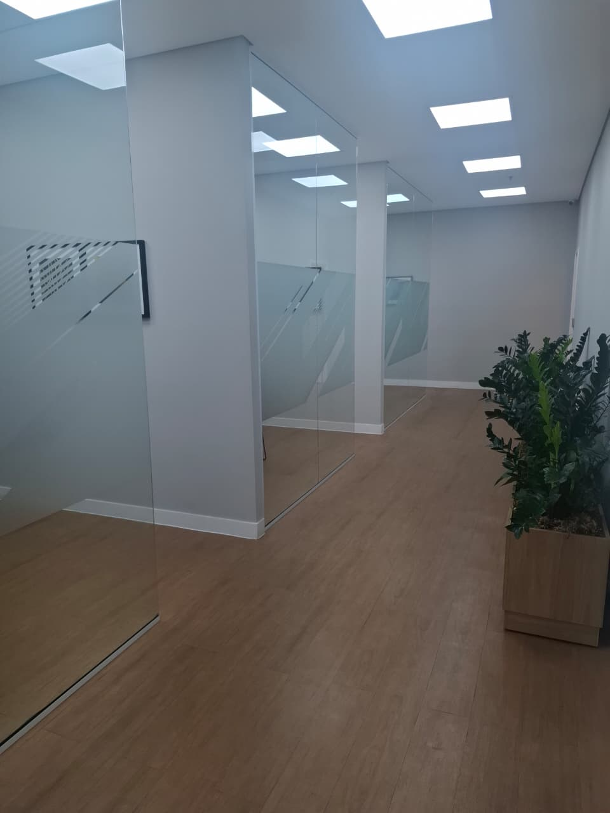
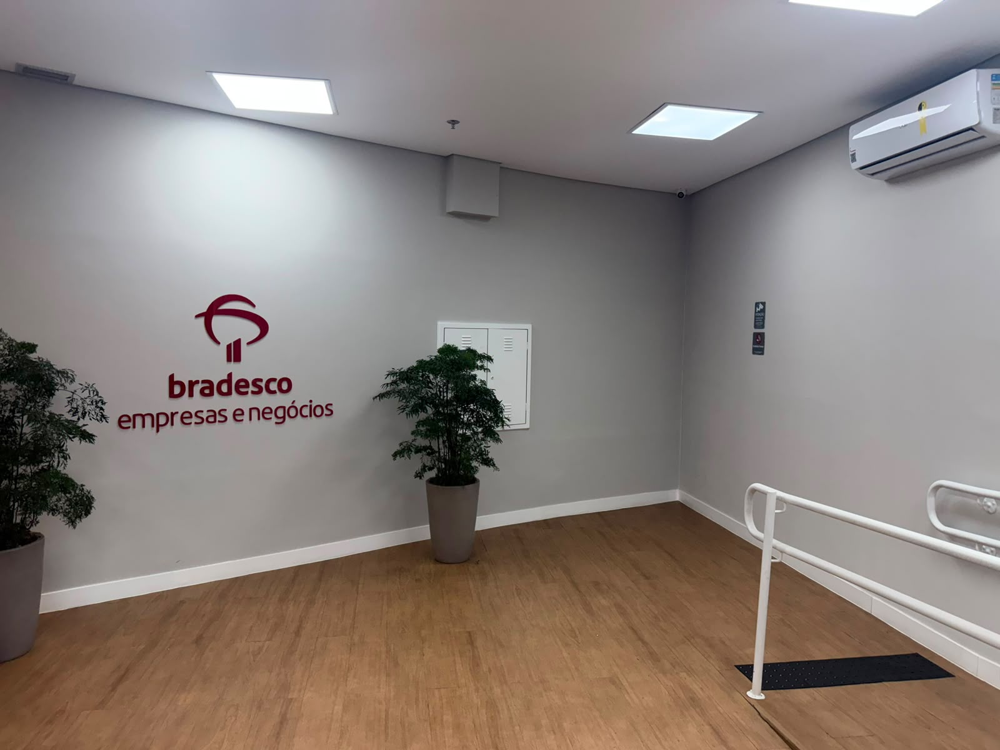
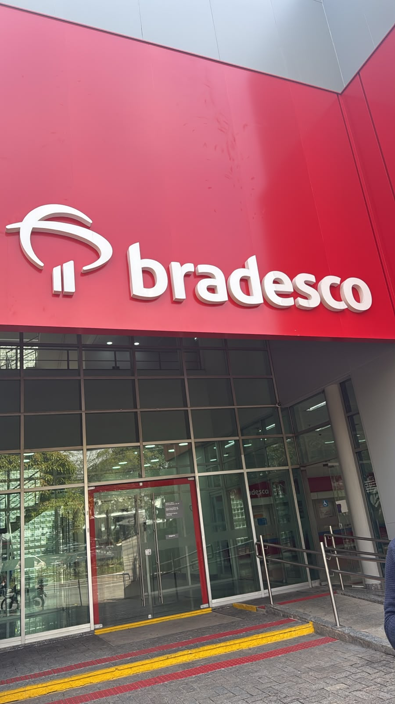
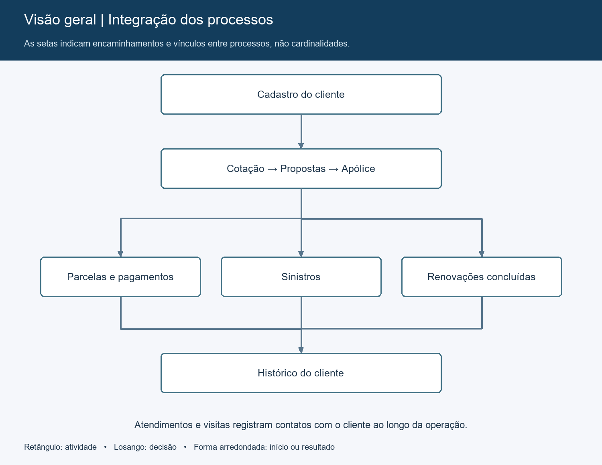
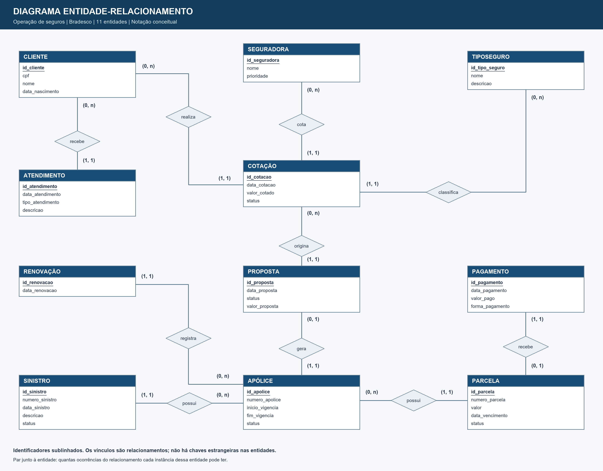
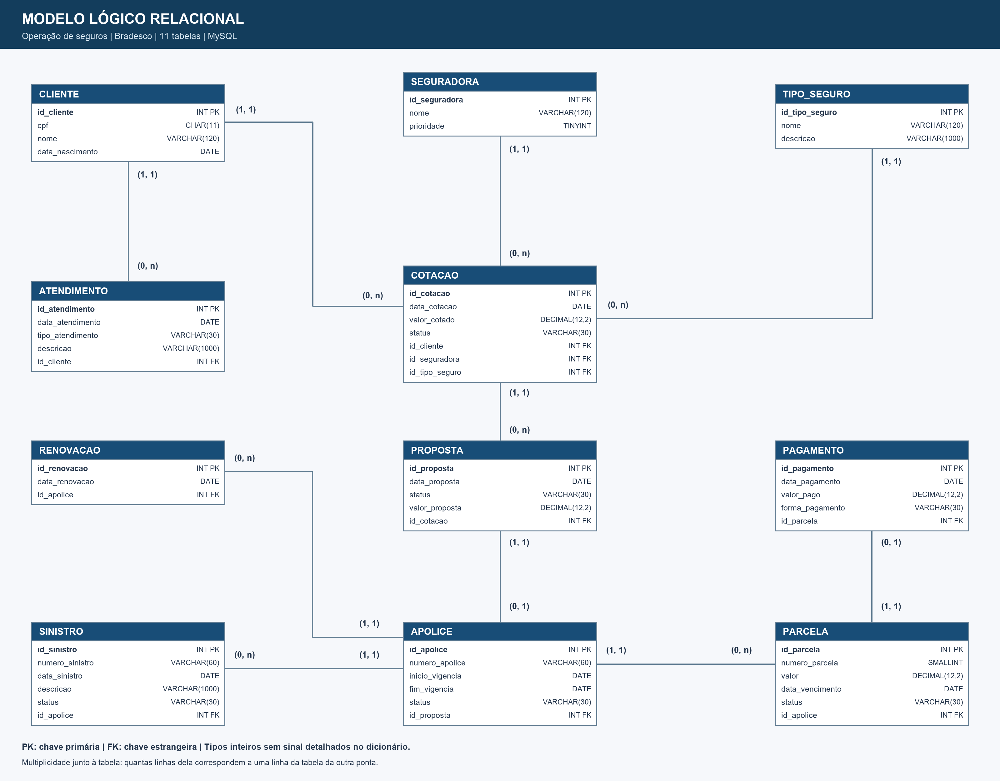

# Entrega 2 — Modelo Lógico, Implementação SQL e Vídeo Explicativo

## Gestão da operação de seguros — Bradesco

[DER conceitual](der/der-conceitual.png) · [Modelo lógico](modelo-logico/modelo-logico.png) · [Dicionário HTML](dicionario-dados/dicionario_de_dados.html) · [Levantamento](levantamento/levantamento.md) · [SQL completo](docs/script.sql)

## Integrantes

| Integrante | RGM | Usuário GitHub |
|---|---|---|
| Mateus Martins Gonçalves | 47812222 | [mateuzzxx](https://github.com/mateuzzxx) |
| Raul Borges Sim | 48247634 | [raulzin085-debug](https://github.com/raulzin085-debug) |
| João Gustavo Bento de Souza | 42283671 | [jogus2007-dot](https://github.com/jogus2007-dot) |
| Victor Alves Rodrigues Braulino | 48216305 | [VictorAlves747](https://github.com/VictorAlves747) |

# 1. Relatório Técnico Final

## 1.1 Revisão do Modelo Conceitual

### Caracterização da organização

O projeto mantém a organização pesquisada na Entrega 1. O levantamento descreve a operação de seguros vinculada ao Bradesco, com visita ao **Banco Bradesco — Agência 2645**, na **Av. Dr. Chucri Zaidan, 80 — Itaim Bibi, São Paulo — SP, CEP 04583-110**. A modelagem disponível representa os processos de seguros levantados na pesquisa; não representa a operação bancária completa da agência.

Segundo as informações fornecidas pelo grupo, a operação tem fins lucrativos, funciona desde 2016, conta com seis funcionários, atende cerca de 50 a 100 clientes por mês e comercializa 50 a 60 seguros mensais. Foi informado faturamento aproximado de R$ 60.000,00 por mês. A seleção decorreu do acesso do grupo ao ambiente e à responsável, permitindo levantar cadastros, contratação, pagamentos, atendimentos, sinistros e renovações.

### Delimitação do escopo e decisões técnicas

As definições abaixo combinam as informações fornecidas pelo grupo com decisões técnicas adotadas nesta versão acadêmica. As limitações de escopo descrevem o que o modelo implementa; não constituem novas respostas da entrevistada nem confirmação de aprovação desse recorte pelo professor.

| Informação | Definição adotada no projeto |
|---|---|
| Recorte da operação de seguros para a Entrega 2 | O objeto modelado é a operação de seguros pesquisada na agência 2645: clientes, seguradoras, tipos de seguro, cotações, propostas, apólices, parcelas, pagamentos, atendimentos, sinistros e renovações. Essa delimitação mantém continuidade com a pesquisa da Entrega 1. A versão não representa toda a atividade bancária da agência. |
| Processos adicionais e justificativas dos processos não incluídos | O modelo cobre cadastro, cotação, proposta, contratação, controle financeiro das parcelas, histórico de atendimentos e visitas, sinistros e registro de renovações concluídas. Contas bancárias, crédito, investimentos, folha de pagamento, comissões e despesas ficam fora desta versão por não terem sido detalhados no levantamento. Essa exclusão delimita o projeto e não significa que tais processos não existam na organização. |
| Cadastro de pessoas jurídicas e dados utilizados | O cadastro implementado representa pessoas físicas, com CPF único, nome e data de nascimento, conforme os dados informados na pesquisa. A oferta de seguro empresarial, isoladamente, não confirma como a organização cadastra pessoas jurídicas. Um cadastro próprio com CNPJ e razão social é uma possibilidade de evolução, não implementada nesta entrega; CNPJ não deve ser armazenado no campo CPF. |
| Agenda de visitas e atribuição de responsáveis | O levantamento registra planejamento semanal em quadro de vidro e uso de papel e planilhas. Nesta versão, Atendimento mantém data, tipo, descrição e vínculo com o cliente, permitindo consultar o histórico de contatos e visitas. Agendamento futuro e atribuição de funcionários não foram implementados; sua inclusão exigiria cadastro de responsáveis e regras de disponibilidade. |
| Vínculo entre apólice anterior e nova apólice na renovação | Conforme a confirmação enviada pelo grupo, somente renovações concluídas são registradas. Renovação guarda a data de conclusão e a referência à apólice relacionada, preservando o registro original. O modelo não identifica uma apólice sucessora e não considera que a renovação altere automaticamente a vigência. Um vínculo explícito entre apólice anterior e nova apólice dependerá da confirmação de como esse processo ocorre na operação. |
| Regras de juros, descontos e estornos | Cada parcela admite no máximo um pagamento, sem pagamentos parciais, conforme confirmado pelo grupo. O pagamento registra valor positivo, data e forma utilizada. Como não foram informadas regras de encargos ou descontos, a implementação não calcula juros ou multas nem impõe igualdade automática entre valor da parcela e valor pago. Diferenças devem ser conferidas; essa flexibilidade não autoriza pagamento parcial. Estornos não estão implementados, e cancelar uma apólice não elimina automaticamente suas parcelas. |
| Formas de pagamento, situações operacionais e antecedência dos alertas | A forma de pagamento é um texto obrigatório e não vazio; os exemplos da massa de testes são fictícios e não constituem lista confirmada da organização. Os estados de cotação, proposta, apólice, parcela e sinistro seguem os domínios definidos no dicionário e no SQL. A consulta G04 adota janela de 30 dias para próximos vencimentos como parâmetro técnico da demonstração, ajustável no SQL, e permite consultar a existência de renovações registradas. Não há envio automático de notificações. |
| Definição do faturamento informado e dos valores de proposta | Os R$ 60.000,00 mensais são uma estimativa relatada pelo grupo, sem confirmação de composição em prêmios, comissões ou receita líquida. Por isso, esse valor caracteriza o levantamento e não é usado como resultado calculado pelo banco. Cotação e proposta armazenam os valores de suas respectivas etapas comerciais, e Pagamento registra o valor efetivamente pago. Somar propostas ou pagamentos não comprova faturamento da operação; os indicadores apresentados devem ser lidos conforme suas definições e usam dados fictícios. |

### Problemas de gestão de informações

| Código | Problema | Dados que o atendem | Consulta |
|---|---|---|---|
| P1 | Histórico do cliente distribuído em controles diferentes | Cliente e cadeia comercial | G01 |
| P2 | Acompanhamento manual de cotações e propostas | Cotação, Proposta, Apólice | G02 |
| P3 | Consulta manual de parcelas vencidas e pagamentos | Parcela, Pagamento, Apólice | G03 |
| P4 | Identificação manual de vencimentos e renovações concluídas | Apólice, Renovação | G04 |
| P5 | Acompanhamento de sinistros em controle separado | Sinistro, Apólice | G05 |
| P6 | Histórico de atendimentos e visitas disperso em papel e planilhas | Atendimento, Cliente | G01 |

A centralização organiza registros e permite consultas integradas. A transferência de anotações de papel continua sendo uma atividade operacional: o banco não digitaliza anotações automaticamente. A agenda futura de visitas, a distribuição de tarefas, comissões, despesas, pessoas jurídicas e alterações contratuais não estão representadas no levantamento disponível. Os controles demonstrados não substituem um sistema bancário nem uma aplicação completa de gestão.

### Evidências e relato da entrevista

A pesquisa foi realizada nas instalações visitadas. O material identifica Patrícia dos Santos Souza como entrevistada. O cargo informado pelo grupo é sócia. João Gustavo Bento de Souza participou da entrevista e aparece nos registros fotográficos. O relato organizado está no [levantamento](levantamento/levantamento.md). As informações dos processos procedem do levantamento do grupo; as fotografias registram o ambiente físico e momentos da entrevista.

| Informação da pesquisa | Registro |
|---|---|
| Data da entrevista | 02/11/2026 |
| Integrantes que participaram da entrevista | João Gustavo Bento de Souza |
| Função informada da entrevistada | Sócia, conforme informação do grupo |
| Telefone autorizado da responsável | (11) 96202-6435 |
| Contato institucional | (11) 96202-6435 |
| Perfil da organização no Google Maps | conteudo pendente |
| Vínculo profissional ou familiar de integrantes com a organização | Patrícia dos Santos Souza, responsável entrevistada, é tia do integrante João Gustavo Bento de Souza. |
| Foto da entrevista no local | [Registro da entrevista](evidencias/foto-entrevista-conversa.jpeg) e [registro junto à identificação da unidade](evidencias/foto-visita-participantes.jpeg) |







#### Registros da entrevista

Fotografias fornecidas pelo grupo como registros da entrevista e da visita à organização.


### Revisão da base da Entrega 1

O grupo informou que o professor considerou o trabalho correto. As adequações abaixo atendem ao novo roteiro e às confirmações de entrevista já recebidas; não são atribuídas a uma correção escrita do professor.

| Origem | Adequação | Justificativa |
|---|---|---|
| Roteiro E2: notação conceitual | Entidades, losangos, identificadores sublinhados e pares (mín, máx) | Distinguir o DER do modelo lógico. |
| Roteiro E2: sem FKs no conceitual | Referências removidas das caixas conceituais e mantidas no modelo lógico | Relacionamentos conceituais não são colunas FK. |
| Entrevista complementar | Cotação 1:N Proposta; Proposta 1:0..1 Apólice | Preservar as cardinalidades confirmadas. |
| Entrevista complementar | Pagamento único por parcela; apólice admite zero parcelas no cadastro | Representar a ordem de cadastramento e a quitação informadas. |
| Entrevista complementar | Somente renovações concluídas | Não armazenar tentativas como conclusões. |
| Roteiro E2: detalhamento | RFs especificam dados e vínculos; RN01–RN20 preservados | Permitir rastrear os campos até a implementação. |

**Apontamentos adicionais da correção da Entrega 1:** o grupo relatou aprovação do professor e a necessidade de adequação à E2; outros comentários mencionados ainda não foram enviados: conteudo pendente.

### Processos de negócio e dados envolvidos



- **Cliente:** Representa os clientes da corretora. Dados: `id_cliente`, `cpf`, `nome`, `data_nascimento`.
- **Seguradora:** Representa as companhias utilizadas nas cotações. Dados: `id_seguradora`, `nome`, `prioridade`.
- **TipoSeguro:** Representa as modalidades de seguros comercializadas. Dados: `id_tipo_seguro`, `nome`, `descricao`.
- **Cotação:** Representa uma cotação realizada para determinado cliente. Dados: `id_cotacao`, `data_cotacao`, `valor_cotado`, `status`, `id_cliente`, `id_seguradora`, `id_tipo_seguro`.
- **Proposta:** Representa uma cotação que avançou para uma etapa de contratação. Dados: `id_proposta`, `data_proposta`, `status`, `valor_proposta`, `id_cotacao`.
- **Apólice:** Representa o seguro contratado. Dados: `id_apolice`, `numero_apolice`, `inicio_vigencia`, `fim_vigencia`, `status`, `id_proposta`.
- **Parcela:** Representa os valores que devem ser pagos relacionados à apólice. Dados: `id_parcela`, `numero_parcela`, `valor`, `data_vencimento`, `status`, `id_apolice`.
- **Pagamento:** Representa o pagamento de uma parcela. Dados: `id_pagamento`, `data_pagamento`, `valor_pago`, `forma_pagamento`, `id_parcela`.
- **Atendimento:** Representa o contato ou atendimento realizado pela corretora ao cliente. Dados: `id_atendimento`, `data_atendimento`, `tipo_atendimento`, `descricao`, `id_cliente`.
- **Sinistro:** Representa uma ocorrência relacionada a uma apólice. Dados: `id_sinistro`, `numero_sinistro`, `data_sinistro`, `descricao`, `status`, `id_apolice`.
- **Renovação:** Representa uma renovação concluída, vinculada à apólice de origem. Dados: `id_renovacao`, `data_renovacao`, `id_apolice`.

O encadeamento é Cliente → Cotação → Proposta → Apólice. Apólice se relaciona a parcelas, sinistros e renovações. O pagamento depende de parcela; o atendimento depende de cliente. Os [fluxogramas detalhados](fluxogramas/) descrevem os oito processos operacionais e sua integração.

### Execução dos processos

A descrição abaixo combina o fluxo relatado com a gravação proposta. A identidade do executor de cada operação e regras adicionais não confirmadas permanecem como conteudo pendente.

| Processo | Início, entradas e execução | Decisão, exceção e saída |
|---|---|---|
| Cadastro | Cliente entra em contato; a equipe consulta CPF e registra nome e nascimento. | CPF já existente deve levar à consulta/atualização do cadastro, sem duplicação. O cliente fica disponível para cotações e atendimentos. |
| Cotação | A equipe levanta a necessidade e consulta seguradora e modalidade; registra data, valor e situação. | Bradesco Seguros é priorizada; outras companhias podem ser consultadas. Cada opção registrada pode permanecer sem proposta. |
| Proposta | Interesse do cliente em prosseguir com uma cotação; registrar data, valor, situação e origem. | Podem existir várias propostas por cotação. Proposta sem contratação permanece registrada; cada proposta gera no máximo uma apólice. |
| Contratação | Efetivação informada gera número, vigência e situação da apólice vinculada à proposta. | Fim deve ser posterior ao início. É permitido registrar a apólice antes das parcelas. Data comercial de emissão/contratação: conteudo pendente. |
| Parcelas | Após a apólice, registrar número, valor e vencimento de cada obrigação. | Número não se repete dentro da apólice. Quantidade e periodicidade reais: conteudo pendente. |
| Pagamento | Recebida informação de quitação, registrar data, valor e forma para uma parcela. | Um pagamento por parcela; a rotina bloqueia duplicidade e grava pagamento/status atomicamente. Falha desfaz a operação. Juros, descontos e estornos: conteudo pendente. |
| Atendimento/visita | Contato com o cliente gera data, tipo e descrição; anotações em papel alimentam o controle. | O registro integra o histórico. Agenda futura e responsável nominal: conteudo pendente. |
| Sinistro | Cliente comunica ocorrência; funcionária responsável acompanha o caso; registrar apólice, data, descrição e situação. | Várias ocorrências por apólice; data fora da vigência é recusada. Acompanhamento atualiza situação; número é registrado quando disponível. |
| Renovação | Proximidade do vencimento motiva contato com cliente. | Somente conclusão gera Renovação com data e apólice de origem. Tentativa sem conclusão não gera esse registro. Vínculo com novo contrato: conteudo pendente. |

### Requisitos funcionais

| Código | Requisito |
|---|---|
| RF01 | Cadastrar cliente com identificador interno, CPF, nome e data de nascimento. |
| RF02 | Consultar clientes por identificador, nome ou CPF, exibindo os dados cadastrais e os vínculos com operações. |
| RF03 | Atualizar nome, CPF e nascimento, preservando o identificador e a unicidade do CPF. |
| RF04 | Cadastrar tipo de seguro com identificador, nome e descrição opcional. |
| RF05 | Cadastrar seguradora com identificador, nome e indicador de prioridade comercial. |
| RF06 | Registrar cotação com identificador, data, valor cotado, status, cliente, seguradora e tipo de seguro. |
| RF07 | Associar cada cotação a exatamente um cliente cadastrado por id_cliente. |
| RF08 | Associar cada cotação a uma seguradora e a um tipo de seguro existentes. |
| RF09 | Registrar proposta com identificador, data, status, valor e cotação de origem; admitir várias propostas para a mesma cotação. |
| RF10 | Consultar e atualizar a situação das propostas, mantendo seu identificador e sua cotação de origem. |
| RF11 | Registrar apólice com identificador, número, início e fim da vigência, status e proposta de origem. |
| RF12 | Consultar número e vigência de cada apólice, verificando início anterior ao fim. |
| RF13 | Cadastrar parcela com identificador, número, valor, vencimento, status e apólice; permitir apólice ainda sem parcelas. |
| RF14 | Registrar um único pagamento por parcela com identificador, data, valor e forma de pagamento; atualizar a parcela na mesma transação. |
| RF15 | Consultar parcelas pagas, pendentes e vencidas a partir do vencimento, do valor e do pagamento associado. |
| RF16 | Registrar atendimento com identificador, data, tipo (atendimento ou visita), descrição opcional e cliente. |
| RF17 | Registrar sinistro com identificador, número quando disponível, data da ocorrência, descrição, status e apólice. |
| RF18 | Consultar e atualizar a situação dos sinistros por identificador ou apólice. |
| RF19 | Listar apólices por fim de vigência e situação, com janela de consulta configurável. |
| RF20 | Registrar somente renovação concluída, com identificador, data de conclusão e apólice de origem. |
| RF21 | Consultar o histórico do cliente pela cadeia Cliente–Cotação–Proposta–Apólice e pelos atendimentos, parcelas, pagamentos, sinistros e renovações associados. |
| RF22 | Pesquisar registros por cliente, apólice, seguradora ou situação, preservando a vinculação entre suas chaves. |

### Requisitos não funcionais

| Código | Requisito e verificação |
|---|---|
| RNF01 | Consultas e saídas devem usar nomes compreensíveis; interface de aplicação não faz parte do script. |
| RNF02 | Acesso operacional deve exigir autenticação na instalação MySQL e na futura aplicação. |
| RNF03 | Permissões devem seguir o papel de cada usuário; o script não cria contas nem define credenciais. |
| RNF04 | Consultas usam PKs, índices das FKs e índices de datas; desempenho deve ser medido com EXPLAIN na instalação utilizada. |
| RNF05 | Integridade referencial por InnoDB, PK, FK, NOT NULL, UNIQUE e CHECK; regras entre tabelas também têm auditorias. |
| RNF06 | Operação deve prever backup e restauração; política e execução pertencem à administração do ambiente. |
| RNF07 | Integridade de identificação verificada pelo teste de duplicidade de CPF; implementa RN02. |
| RNF08 | Novos tipos de seguro são incluídos como registros, sem mudança de estrutura. |
| RNF09 | Novas seguradoras são incluídas como registros, sem mudança de estrutura. |
| RNF10 | Demonstração exclusivamente com dados fictícios, sem exportação de dados reais de clientes. |

### Regras de negócio

| Código | Regra |
|---|---|
| RN01 | Cada cliente deve possuir CPF, nome e data de nascimento cadastrados. |
| RN02 | O CPF deve identificar unicamente um cliente. |
| RN03 | A corretora trabalha com diferentes tipos de seguros. |
| RN04 | Uma cotação deve estar associada a um cliente. |
| RN05 | Uma cotação deve estar associada a uma seguradora. |
| RN06 | A Bradesco Seguros é priorizada nas cotações, conforme informação fornecida pela organização. |
| RN07 | Outras seguradoras podem ser consultadas quando necessário. |
| RN08 | Cada proposta tem uma cotação de origem; uma cotação pode gerar várias propostas ou nenhuma. |
| RN09 | Nem toda cotação necessariamente resulta em uma proposta. |
| RN10 | Uma apólice deve possuir número e período de vigência. |
| RN11 | A data inicial da vigência deve ser anterior à data final. |
| RN12 | Uma apólice pode ser cadastrada antes das parcelas e posteriormente possuir várias parcelas. |
| RN13 | Uma parcela deve estar vinculada a uma apólice. |
| RN14 | Cada pagamento pertence a uma parcela; cada parcela recebe no máximo um pagamento, sem pagamentos parciais. |
| RN15 | Cada sinistro pertence a uma apólice; uma apólice pode ter vários sinistros durante sua vigência. |
| RN16 | Os sinistros possuem acompanhamento específico dentro da organização. |
| RN17 | Os atendimentos devem estar relacionados aos clientes. |
| RN18 | As apólices devem ser acompanhadas quanto ao vencimento. |
| RN19 | Somente renovações concluídas devem ser registradas; tentativas sem renovação não são armazenadas. |
| RN20 | As informações dos clientes devem ser protegidas contra acesso não autorizado. |
| RN21 | Cada proposta pode gerar no máximo uma apólice (confirmação da entrevista complementar). |
| RN22 | A combinação de apólice e número de parcela é única; número e valor da parcela são positivos (decisão técnica). |
| RN23 | Parcela paga possui pagamento correspondente; parcela pendente não possui pagamento. A gravação conjunta deve ser transacional (decisão técnica). |

RN21 explicita a confirmação já recebida sobre proposta e apólice. RN22 e RN23 formalizam decisões de integridade da implementação. Domínios de status e tamanhos são parâmetros técnicos da proposta, documentados no dicionário.

### DER revisado



Criado com **Python/Pillow e SVG**, seguindo os elementos conceituais indicados no roteiro: retângulos, losangos, identificadores sublinhados e cardinalidades mínimas e máximas. Não foi gerado no aplicativo brModelo. Os atributos estão dentro das entidades, alternativa aceita no roteiro. O par junto à entidade conta quantas ocorrências dela podem corresponder a uma ocorrência da entidade na outra ponta. Em Cliente–Cotação, (1,1) fica junto de Cliente e (0,n) junto de Cotação.

## 1.2 Conversão do Modelo Conceitual para o Modelo Lógico

Cada uma das 11 entidades origina uma tabela; seus atributos simples originam colunas. No lado dependente dos relacionamentos 1:N, acrescenta-se uma FK obrigatória. A ausência de dependentes é permitida, possibilitando cadastrar clientes, cotações e apólices antes deles. Não existem relacionamentos N:N nem generalização/especialização na base levantada; por isso não foram criadas tabelas associativas ou hierarquias artificiais.

Proposta–Apólice e Parcela–Pagamento usam FK NOT NULL com UNIQUE na tabela dependente, garantindo no máximo um dependente por origem. Cotação–Proposta usa FK sem UNIQUE, permitindo várias propostas. A opção RESTRICT preserva os vínculos ao excluir ou alterar chaves.


### Conversão por relacionamento

| Tabela dependente | Referência obrigatória | Dependentes por origem | Implementação e justificativa |
|---|---|---|---|
| cotacao | id_cliente → cliente.id_cliente | 0..N | NOT NULL + FK; FK pode repetir, permitindo vários dependentes. |
| cotacao | id_seguradora → seguradora.id_seguradora | 0..N | NOT NULL + FK; FK pode repetir, permitindo vários dependentes. |
| cotacao | id_tipo_seguro → tipo_seguro.id_tipo_seguro | 0..N | NOT NULL + FK; FK pode repetir, permitindo vários dependentes. |
| proposta | id_cotacao → cotacao.id_cotacao | 0..N | NOT NULL + FK; FK pode repetir, permitindo vários dependentes. |
| apolice | id_proposta → proposta.id_proposta | 0..1 | NOT NULL + FK + UNIQUE; máximo de um dependente. |
| parcela | id_apolice → apolice.id_apolice | 0..N | NOT NULL + FK; FK pode repetir, permitindo vários dependentes. |
| pagamento | id_parcela → parcela.id_parcela | 0..1 | NOT NULL + FK + UNIQUE; máximo de um dependente. |
| atendimento | id_cliente → cliente.id_cliente | 0..N | NOT NULL + FK; FK pode repetir, permitindo vários dependentes. |
| sinistro | id_apolice → apolice.id_apolice | 0..N | NOT NULL + FK; FK pode repetir, permitindo vários dependentes. |
| renovacao | id_apolice → apolice.id_apolice | 0..N | NOT NULL + FK; FK pode repetir, permitindo vários dependentes. |

Nos vínculos 1:0..1, manter tabelas separadas evita campos de apólice em propostas não contratadas e campos de pagamento em parcelas pendentes. Colocar a FK obrigatória e única no dependente permite que a origem exista sem ele. Uma tabela única seria alternativa com campos opcionais e restrições adicionais, mas misturaria eventos de ciclos distintos.

## 1.3 Definição de Chaves Primárias e Estrangeiras

| Tabela | PK | FKs | Outras unicidades |
|---|---|---|---|
| cliente | id_cliente | — | cpf: UNIQUE |
| seguradora | id_seguradora | — | — |
| tipo_seguro | id_tipo_seguro | — | — |
| cotacao | id_cotacao | id_cliente → cliente; id_seguradora → seguradora; id_tipo_seguro → tipo_seguro | — |
| proposta | id_proposta | id_cotacao → cotacao.id_cotacao | — |
| apolice | id_apolice | id_proposta → proposta.id_proposta | id_proposta: UNIQUE |
| parcela | id_parcela | id_apolice → apolice.id_apolice | numero_parcela: UNIQUE (id_apolice, numero_parcela) |
| pagamento | id_pagamento | id_parcela → parcela.id_parcela | id_parcela: UNIQUE |
| atendimento | id_atendimento | id_cliente → cliente.id_cliente | — |
| sinistro | id_sinistro | id_apolice → apolice.id_apolice | — |
| renovacao | id_renovacao | id_apolice → apolice.id_apolice | — |

## 1.4 Processo de Normalização (1FN, 2FN e 3FN)

**1FN:** o modelo guarda um valor por coluna e uma ocorrência por linha. Não existem colunas parcela1/parcela2 nem listas de propostas, sinistros ou pagamentos dentro da apólice. As parcelas e propostas são linhas próprias, não grupos repetitivos.

**2FN:** cada PK escolhida é simples, eliminando dependências parciais dessa PK. As chaves candidatas CPF, id_proposta na apólice e id_parcela no pagamento também são simples. A chave candidata composta (id_apolice, numero_parcela) determina valor, vencimento e situação da parcela; esses dados não dependem apenas de um dos componentes.

**3FN:** nomes de cliente, seguradora e modalidade permanecem em seus cadastros; não são repetidos em propostas, apólices ou parcelas. Em Cotação, id_cotacao determina id_cliente, id_seguradora e id_tipo_seguro; os nomes determinados por essas referências são obtidos por JOIN. O cliente de uma apólice é encontrado por Proposta → Cotação, sem duplicar id_cliente na apólice.

| Relação | Dependência funcional principal |
|---|---|
| cliente | id_cliente → cpf, nome, data_nascimento |
| seguradora | id_seguradora → nome, prioridade |
| tipo_seguro | id_tipo_seguro → nome, descricao |
| cotacao | id_cotacao → data_cotacao, valor_cotado, status, id_cliente, id_seguradora, id_tipo_seguro |
| proposta | id_proposta → data_proposta, status, valor_proposta, id_cotacao |
| apolice | id_apolice → numero_apolice, inicio_vigencia, fim_vigencia, status, id_proposta |
| parcela | id_parcela → numero_parcela, valor, data_vencimento, status, id_apolice |
| pagamento | id_pagamento → data_pagamento, valor_pago, forma_pagamento, id_parcela |
| atendimento | id_atendimento → data_atendimento, tipo_atendimento, descricao, id_cliente |
| sinistro | id_sinistro → numero_sinistro, data_sinistro, descricao, status, id_apolice |
| renovacao | id_renovacao → data_renovacao, id_apolice |

A normalização preserva as entidades da base já separada. Não se inventou uma tabela desnormalizada anterior como se tivesse sido fornecida pela organização. O status da parcela é informação redundante em relação à existência do pagamento; mantê-lo exige atualização transacional. A rotina `registrar_pagamento` faz a gravação conjunta; A04 detecta divergências introduzidas por alterações manuais. A 3FN não elimina automaticamente inconsistências entre tabelas nem resolve regras temporais.

### Exemplos didáticos de normalização

Armazenar o nome da seguradora em cada cotação exigiria atualizar diversas linhas quando o nome mudasse; mantê-lo em Seguradora evita essa anomalia. Separar Cliente de Cotação permite cadastrar um cliente antes de haver cotação e evita perder seu cadastro ao excluir uma cotação. São exemplos didáticos, não descrições de uma tabela antiga observada.

A chave candidata (id_apolice, numero_parcela) identifica uma parcela dentro de um contrato: valor e vencimento dependem da combinação, não apenas do contrato nem do número isolado. As demais chaves candidatas identificadas são as PKs, CPF de Cliente, id_proposta de Apólice e id_parcela de Pagamento. A conclusão sobre 2FN considera essas chaves, não somente a existência de PKs simples. A redundância entre status da parcela e presença do pagamento é uma regra entre tabelas, tratada pela rotina transacional e pela auditoria A04.

## 1.5 Justificativas Técnicas das Decisões

Identificadores inteiros internos permanecem estáveis mesmo se nome, CPF ou número comercial forem corrigidos. CPF é chave candidata única (RN02), mas não é usado como FK para evitar sua repetição. Datas usam DATE; valores monetários usam DECIMAL(12,2), sem ponto flutuante. Números de apólice e sinistro usam texto para preservar zeros, letras e separadores.

| Restrição / decisão | Aplicação | Fundamento |
|---|---|---|
| NOT NULL | Identificadores, vínculos obrigatórios e dados essenciais | RN01, RN04, RN05, RN10, RN13, RN14, RN17, RN19 |
| UNIQUE | CPF; proposta na apólice; parcela no pagamento; número de parcela por apólice | RN02, RN21, RN14, RN22 |
| CHECK | Vigência ordenada, valores, números positivos e domínios de situação | RN11, RN22 e domínios técnicos documentados |
| FK + RESTRICT | Todas as referências | RN04, RN05, RN08, RN13, RN14, RN15, RN17, RN19 |
| DEFAULT 0 | Prioridade comercial da seguradora | Escolha técnica: a prioridade deve ser marcada explicitamente (RN06/RN07). |
| Índices de datas | Fim de vigência, vencimento e atendimento | Apoiar RF15, RF16 e RF19. |
| Rotina registrar_pagamento e auditoria A04 | Pagamento e status gravados na mesma transação, com bloqueio da parcela | RN14/RN23; alterações manuais ainda exigem auditoria. |
| Triggers de Sinistro e Apólice e auditoria A05 | Bloqueio de ocorrência fora da vigência, inclusive ao alterar a apólice | RN15; primeiro e último dia incluídos. |

O formato de CPF é conferido por 11 dígitos e unicidade; os dígitos verificadores não são calculados pelo script. Não foi imposta unicidade global a numero_apolice sem conhecer sua abrangência entre seguradoras. Uma data de renovação registra conclusão, sem inventar contatos ou supor um novo contrato associado.

A documentação técnica foi conferida com o [manual oficial do MySQL sobre FKs](https://dev.mysql.com/doc/refman/8.4/en/create-table-foreign-keys.html) e [CHECKs](https://docs.oracle.com/cd/E17952_01/mysql-8.4-en/create-table-check-constraints.html). Os reforços seguem a documentação de [triggers e rotinas](https://dev.mysql.com/doc/refman/8.4/en/stored-program-restrictions.html).

## 1.6 Proposta de Arquitetura Analítica para BI e IA

A proposta utiliza o banco transacional como fonte para extrações somente de leitura. Uma camada analítica pode reunir fatos de início de vigência (uma apólice), vencimento (uma parcela), pagamento (um pagamento), atendimento (um registro) e renovação (uma conclusão), com dimensões de data, seguradora e modalidade. Cada fato mantém sua granularidade para evitar multiplicar valores ao combinar várias parcelas e vários sinistros da mesma apólice.

| KPI | Fórmula | Período / recorte | Consulta |
|---|---|---|---|
| KPI1 — Atendimentos e visitas | COUNT dos registros por tipo | Mês do atendimento | G06 |
| KPI2 — Cotações com vigência iniciada | 100 × cotações com ao menos uma apólice cuja vigência iniciou até a referência / cotações do período | Coorte mensal; início da vigência até a referência | G07 |
| KPI3 — Percentual vencido em aberto | 100 × valor vencido sem pagamento até a referência / valor vencido | Posição na data de referência | G08 |
| KPI4 — Inícios de vigência | COUNT das apólices | Mês do início de vigência | G09 |
| KPI5 — Valor médio das propostas vinculadas | AVG do valor da proposta ligada à apólice | Mês do início de vigência | G09 |
| KPI6 — Renovações concluídas | COUNT das renovações | Mês da conclusão | G10 |

Não foram estabelecidas metas comerciais pela organização. Valor de proposta, prêmio, comissão e faturamento não são tratados como sinônimos. KPI4 conta inícios de vigência e inclui contratos posteriormente cancelados; não representa data de emissão, contratação ou carteira ativa. Não se calcula taxa de renovação sem conhecer os contratos elegíveis e os vínculos entre ciclos. Não se promete análise histórica de cancelamentos porque o modelo contém status atual, sem data de cada mudança.

### Rastreabilidade

| Problema ou KPI | Tabelas | Consulta |
|---|---|---|
| P1 — Histórico do cliente distribuído em controles diferentes | Cliente e cadeia comercial | G01 |
| P2 — Acompanhamento manual de cotações e propostas | Cotação, Proposta, Apólice | G02 |
| P3 — Consulta manual de parcelas vencidas e pagamentos | Parcela, Pagamento, Apólice | G03 |
| P4 — Identificação manual de vencimentos e renovações concluídas | Apólice, Renovação | G04 |
| P5 — Acompanhamento de sinistros em controle separado | Sinistro, Apólice | G05 |
| P6 — Histórico de atendimentos e visitas disperso em papel e planilhas | Atendimento, Cliente | G01 |
| KPI1 | atendimento | G06 |
| KPI2 | cotacao, proposta, apolice | G07 |
| KPI3 | parcela, pagamento | G08 |
| KPI4 | apolice, proposta | G09 |
| KPI5 | apolice, proposta | G09 |
| KPI6 | renovacao | G10 |

**Validação dos indicadores e metas pela organização:** conteudo pendente

### Potencial de BI e IA

Dashboards podem exibir inícios de vigência por período e modalidade, parcelas em aberto, vencimentos próximos e volume de atendimento. A consulta de coortes usa EXISTS para contar cada cotação uma única vez, mesmo quando ela gera várias propostas. As consultas de renovação também evitam repetir uma apólice por múltiplas conclusões.

Em uma evolução com histórico suficiente, séries mensais podem apoiar previsão de demanda de atendimento e detecção de alterações nos volumes. A avaliação deve comparar o modelo com uma referência simples e separar treino e teste por tempo. Os dados fictícios desta entrega servem para demonstração, não para validar previsões reais. Não se propõe decisão automática de aceitação de seguro, preço ou perfil individual; faltam dados e validação para esses usos. Identificadores pessoais não são necessários nos painéis agregados.

### Critérios de leitura dos indicadores

G01 retorna uma linha por evento e inclui descrição/status/valor conforme sua natureza; identificadores de entidades diferentes não são comparáveis. Essa consulta atende P1 e P6. G06 mede volume mensal, não substitui o histórico detalhado. G04 inclui apólices com e sem renovação até a referência; a massa possui cinco de cada. G05 inclui situações Registrado e Em acompanhamento.

G07 mede a existência de apólice com vigência iniciada, não uma data de contratação ainda não levantada. G08 apresenta valor vencido e valor em aberto em reais, além do percentual em aberto. G09 agrupa pelo início da vigência. As consultas não excluem automaticamente parcelas de apólices canceladas: o levantamento não confirmou que cancelamento extingue a dívida. Esses resultados representam pendências registradas, não autorização de cobrança. A06 testa integridade estrutural, não comprova a conclusão comercial de uma renovação.

# 2. Modelo Lógico Relacional



Criado com **Python/Pillow e SVG**. Cada tabela apresenta nome, uma coluna por linha, tipo à direita e marcas PK/FK, com pares de cardinalidade nas ligações. Restrições completas, tamanhos, obrigatoriedade e valores padrão estão no [dicionário HTML](dicionario-dados/dicionario_de_dados.html). O diagrama é uma representação visual; não é um arquivo nativo do brModelo.

**Referência do dicionário:** exemplo 02-03g consultado; convenções, definições formais, fluxo, índices e metadados adaptados ao projeto.

# 3. Script SQL Completo

O arquivo [docs/script.sql](docs/script.sql) contém CREATE DATABASE, CREATE TABLE com restrições, INSERT, SELECT com JOIN, UPDATE, DELETE, consultas gerenciais G01–G10, auditorias A01–A08, três triggers de vigência e a rotina `registrar_pagamento`. O destino é **MySQL 8.0.16 ou superior**, com InnoDB.

Executar o arquivo completo em uma instalação de testes onde o banco `corretora_seguros_e2` ainda não exista. O script não contém DROP DATABASE. Os exemplos UPDATE e DELETE usam transação com ROLLBACK para preservar a massa de demonstração. As consultas usam data de referência fixa em 31/10/2026, com período de setembro a outubro de 2026; as variáveis podem ser alteradas para outro recorte.

O script foi executado do zero no **MySQL Community Server 8.4.13**, com 11 tabelas e 1.266 registros fictícios. Foram conferidas as dez consultas gerenciais, as oito auditorias e 31 casos de rejeição de dados inválidos. Os exemplos UPDATE e DELETE preservaram os dados após ROLLBACK. A massa foi corrigida para que a divisão em parcelas não produza diferenças de centavos. O [registro dos testes](docs/validacao-mysql.md) detalha os resultados e seus limites. Os testes adicionais verificaram pagamento concorrente, reversão integral em caso de falha e os limites da vigência. Antes da gravação do vídeo, o grupo deve repetir a execução no ambiente que utilizará.

O [guia de execução e demonstração](docs/guia-execucao.md) apresenta a importação e o uso da rotina. `registrar_pagamento` controla sua própria transação e deve ser chamada isoladamente, sem transação anterior aberta. Não foram configurados usuários ou permissões de uma aplicação: alterações diretas nas tabelas ainda podem produzir divergência entre pagamento e status, detectada por A04. Não se impõe igualdade entre valor pago e valor da parcela até confirmar juros e descontos.

| Código | Pergunta | Atende / verifica |
|---|---|---|
| G01 | Qual é o histórico integrado do cliente selecionado? | P1; P6; RF21 |
| G02 | Quais cotações estão sem proposta e quais propostas ainda não geraram apólice? | P2; RF06, RF09 |
| G03 | Quais parcelas vencidas continuam sem pagamento? | P3; RF15 |
| G04 | Quais apólices vencem nos próximos 30 dias e quais já têm renovação registrada? | P4; RF19, RF20 |
| G05 | Quais sinistros ainda não foram encerrados? | P5; RF18 |
| G06 | Quantos atendimentos e visitas foram registrados por mês? | KPI1; RF16 |
| G07 | Qual percentual de cotações possui apólice com vigência iniciada até a referência? | KPI2 |
| G08 | Qual percentual do valor vencido permanece sem pagamento na data de referência? | KPI3 |
| G09 | Quantas apólices iniciaram vigência e qual o valor médio de suas propostas por mês? | KPI4; KPI5 |
| G10 | Quantas renovações concluídas foram registradas por mês? | KPI6 |
| A01 | Existem CPFs duplicados? | RN02 |
| A02 | Existe proposta vinculada a mais de uma apólice? | RN21 |
| A03 | Existe parcela com mais de um pagamento? | RN14 |
| A04 | Existem parcelas cujo status contradiz a existência de pagamento? | RN14; RN23 |
| A05 | Existe sinistro fora da vigência informada? | RN15 |
| A06 | Existem renovações sem data de conclusão ou sem apólice válida? | RN19 |
| A07 | Existem números de parcela repetidos na mesma apólice? | RN22 |
| A08 | Existem períodos de vigência inválidos? | RN11 |

# 4. Massa de Dados

A massa é **inteiramente fictícia**, incluída no script. Nomes “Cliente Fictício”, números de documentos e identificadores de contratos foram gerados para teste, sem consulta a cadastros reais. CPFs são sequências de teste que atendem ao formato do esquema, não documentos validados.

| Tabela | Quantidade | Critério |
|---|---|---|
| cliente | 90 | 90 cadastros; 75 com movimentação mensal e 15 sem movimentação. |
| seguradora | 3 | Uma companhia priorizada e duas companhias explicitamente fictícias. |
| tipo_seguro | 7 | Modalidades informadas no levantamento. |
| cotacao | 190 | 90 por mês em dois meses, mais 10 da carteira histórica; quantidade de propostas e cotações é cenário de teste. |
| proposta | 150 | 70 por mês, mais 10 históricas; contempla várias propostas por cotação e propostas não contratadas. |
| apolice | 120 | 55 por mês em dois meses, dentro do volume informado; 10 históricas para vencimentos. |
| parcela | 357 | Três parcelas por apólice no cenário fictício, exceto uma ainda sem parcelas; não é regra da organização. |
| pagamento | 156 | Parte das parcelas vencidas quitada, preservando casos em aberto e formas variadas. |
| atendimento | 180 | 80 em setembro e 100 em outubro, para 75 clientes distintos, dentro da faixa de clientes atendidos informada. |
| sinistro | 8 | Cenário de teste com oito ocorrências, incluindo duas para a mesma apólice; volume não medido em campo. |
| renovacao | 5 | Cinco conclusões na carteira histórica; volume não medido em campo. |

Os valores propostos em outubro são 10% maiores que o cenário de setembro; a média das propostas das apólices passa de R$ 1.700,00 para R$ 1.870,00. Essa variação é fictícia e não representa tendência da organização.

A diversidade inclui clientes sem contratação, cotações sem proposta, propostas recusadas, contratos cancelados, apólice sem parcela, parcelas pagas e pendentes, sinistros abertos e encerrados e renovações concluídas. As auditorias de integridade devem retornar zero inconsistências na massa válida; demonstrar violação requer um teste controlado, seguido de reversão.

# 5. Repositório GitHub

```text
README.md
der/                 DER conceitual em PNG e SVG
modelo-logico/       Diagrama lógico em PNG e SVG
dicionario-dados/    Dicionário único em HTML
levantamento/        Relato organizado da pesquisa
evidencias/          Fotografias em JPG
fluxogramas/         Integração e processos operacionais
docs/                Script SQL, validação e guia de execução
roteiro-video.md     Roteiro do vídeo com divisão entre os quatro integrantes
```

O relatório técnico ocupa o README da raiz. Os artefatos ficam em arquivos próprios e são acessados pelos links deste relatório. O histórico registra as alterações efetivamente realizadas. Contribuições dos integrantes devem corresponder ao trabalho feito por cada um e à sua própria conta.

# 6. Uso de Inteligência Artificial

**Ferramenta: ChatGPT/Codex — OpenAI.** A pesquisa de campo, fotografias e respostas da responsável foram fornecidas pelo grupo. A ferramenta apoiou a organização e a revisão da documentação e, nesta etapa, a preparação dos modelos, tipos SQL, massa fictícia e consultas. A participação da ferramenta não substitui o levantamento nem a compreensão do trabalho pelos integrantes.

| Etapa | Motivação e pedido | Resultado e revisão |
|---|---|---|
| Organização da E1 | Organizar os materiais da visita e adequar ao roteiro. | Estrutura documental, dicionário e diagramas; respostas complementares corrigiram cardinalidades. |
| Adequação à E2 | Pedido: “le esse pdf revise tudo que tem ja pronto e oq for para adicoonar me fala q te mando”. | Comparação com o novo roteiro; separação do DER conceitual e do modelo lógico. |
| Implementação e dados de teste | Pedido complementar: “tudo q estiver na entrega 2 pode altera”. | Preparação de SQL, dados fictícios, normalização e consultas rastreáveis. |

### Fontes e escolhas

A revisão do dicionário utilizou a estrutura do [exemplo 02-03g](https://drive.google.com/file/d/1GyUEndR5ma5oBbZ2_y6IE_z8C9mOLDqE/view): convenções, definições formais, relacionamentos, atributos, restrições e metadados administrativos, adaptados ao domínio de seguros.

Foram usados o roteiro da Entrega 2, o conteúdo já publicado na Entrega 1, o dicionário fornecido, as fotografias e as respostas complementares da entrevista. A sintaxe e as limitações gerais de FKs/CHECKs foram consultadas na documentação oficial do MySQL indicada na seção 1.5. A proposta não acrescenta processos bancários, comissões ou dados de pessoas jurídicas como se tivessem sido levantados.

### Correções e reflexão crítica

As referências de relacionamento foram retiradas das entidades conceituais, mantendo as FKs somente no lógico. A conversão de cotações usa contagem por cotação, evitando duplicação por várias propostas. Os valores de proposta não foram denominados faturamento. Os volumes sem medição de campo são identificados como cenários de teste. A revisão técnica não foi atribuída a uma nova entrevista e não se declara que todos os integrantes já a validaram.

A IA pode propor tipos, consultas e regras incompatíveis com o processo real. A massa fictícia não comprova desempenho ou qualidade preditiva em produção. O uso de consultas de auditoria não equivale ao bloqueio automático de todas as inconsistências. A validação funcional depende das regras da organização e da execução real no SGBD.

### Registro do uso de IA nesta revisão

Em 07/11/2026, o grupo forneceu um plano de correção e pediu: “oq for da minha responsabilidade do grupo so me fale porem oq der para fazer faça”. A revisão utilizou o roteiro, o exemplo 02-03g e o recurso de cardinalidade do professor. Foram corrigidos os pares do conceitual, ampliados processos/conversão/normalização e revistos os nomes dos indicadores. Regras de renovação, cobrança após cancelamento e organização não foram inventadas. O roteiro do vídeo foi preparado com apoio da IA, a partir do relatório e dos resultados executados. A massa fictícia ganhou variação mensal, mantendo os vínculos e a conferência independente das consultas. Os testes automatizados verificam a implementação, não comprovam validação coletiva ou entrevista adicional.

# 7. Vídeo Explicativo da Entrega

A entrega será explicada em vídeo, com duração máxima de **8 minutos**. O [roteiro de gravação](roteiro-video.md) distribui cerca de **1min30 por integrante**, totalizando aproximadamente **6 minutos**, com margem para transições e demonstração na tela.

| Ordem | Integrante | Conteúdo | Tempo previsto |
|---|---|---|---|
| 1 | João Gustavo Bento de Souza | Organização, entrevista e problema identificado | 1min30 |
| 2 | Mateus Martins Gonçalves | Processos e DER conceitual | 1min30 |
| 3 | Raul Borges Sim | Modelo lógico, dicionário e integridade no SQL | 1min30 |
| 4 | Victor Alves Rodrigues Braulino | Consultas, validação e conclusão | 1min30 |

O vídeo deve mostrar os arquivos e exemplos explicados, com texto legível e resultados identificados como provenientes de dados fictícios. O roteiro indica as telas de cada trecho e os cuidados para reproduzir as consultas. A divisão é uma proposta de gravação e não atribui autoria exclusiva das etapas.

**Link do vídeo final:** conteudo pendente

**Ambiente e versão do MySQL utilizados na gravação:** conteudo pendente
